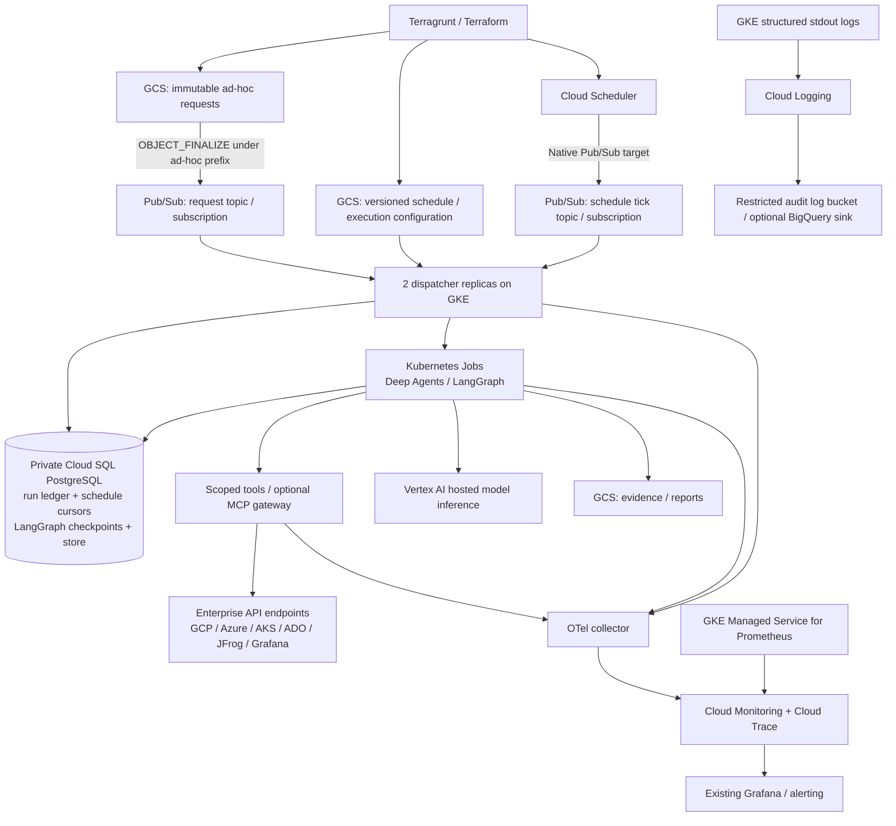

# GCP capacity and observability recommendation

> Baseline research. Use the [11 October phase-1 scope](harness-phase1-scope-2026-10-11.md) and [phase-1 observability review](phase1-observability-access-2026-10-11.md) for current placement, concurrency, telemetry and query boundaries. Reuse the existing observability GKE cluster and Alloy/Loki/Mimir suite; begin with two active Jobs. Investigations cover CI/CD infrastructure/tools only, excluding application deployment target clusters and their telemetry.

Reviewed 2026-10-09. This is a proposed starting configuration, not a measured capacity guarantee or a deployment. The workload assumptions are up to approximately 50 investigations/day, five simultaneous runs, primarily API/log reads, remote model inference, and a typical run lasting 5–30 minutes. Reassess against real run lengths, evidence sizes and backend/model limits.

## Recommended placement

Use a suitable existing regional GKE cluster in the same region/VPC as the majority of CI/CD systems before creating a new cluster. It must support Workload Identity Federation for GKE, protected namespaces, network policies, adequate node/pod quotas and private backend routing. Sharing with existing Argo CD or JFrog infrastructure is not automatic: account for failure domains, privileged workloads and available capacity.

If no suitable cluster exists, create a private regional GKE Autopilot cluster in a dedicated harness project/subnet with Dataplane V2 and Workload Identity. The regular pipeline continues to push images to JFrog; Argo CD ApplicationSet deploys fixed image digests from the CD repository. No Artifact Registry mirror or Cloud Run resource is required for this GKE architecture.

For a dedicated GKE Standard alternative, three e2-standard-4 nodes distributed across the region are a reasonable initial HA capacity estimate, with a *total* cluster autoscaler floor of three and ceiling of nine nodes, not three per zone. Set/check per-zone versus total autoscaling flags. Autopilot avoids node management but its pod request adjustment, resource ratios, compute-class availability and autoscaling latency must be considered; do not promise exact billed CPU/memory from a generic Kubernetes request.

Logical Deep Agents subagents do not each need a pod. One Kubernetes Job can contain a parent agent and bounded subagents executing through LangGraph. Make separate worker deployments/execution classes where there is an actual identity or resource isolation boundary, such as production versus staging. External LLM inference requires no GPU in GKE.

## Resource layout

Schedule messages are wake-up signals. A transactional SQL cursor calculates nominal cron occurrences, and a unique `(schedule_id, nominal_due_at)` key controls deduplication. Scheduler retries/message publish times must not become unique occurrence identities. Explicitly configure timezone, overlap and misfire behavior. A sensible first policy is `skip overlap` and coalesce old missed occurrences into one current investigation rather than flooding the cluster with stale catch-up runs. A periodic dispatcher reconciliation can discover due schedules after a missing wake-up signal.

## Starting sizes and scaling

| Resource | Suggested first production size/configuration | Scale and constraints |
|---|---|---|
| Dispatcher | 2 replicas, each 250m CPU / 512 MiB; requests equal appropriate limits for chosen GKE mode | 2–4 replicas on Pub/Sub backlog/age and intake rate; replicas share SQL transactions/leases. More replicas must not increase the global execution cap. |
| Worker Job | 1 vCPU / 2 GiB memory / 2–5 GiB ephemeral storage; one parent, at most 2–3 simultaneous subagents | Initially five active Jobs total, with stricter per-execution-class caps. For data-heavy parsing, use an explicit 2 vCPU / 4 GiB class rather than every worker defaulting larger. Stream evidence to GCS instead of keeping large log payloads in RAM. |
| Job controls | `activeDeadlineSeconds: 1800`, `backoffLimit: 2` after checkpoint recovery testing, `ttlSecondsAfterFinished: 86400`; explicit graceful termination | Extend timeout only for known needs. SQL lease and deterministic Job name guard concurrent/retried execution. Kubernetes can start a program twice even with simple single-completion settings; do not assume exactly-once execution. |
| Optional MCP/tool gateway | 2 replicas, each 500m CPU / 1 GiB | 2–6 replicas on CPU/in-flight calls; enforce a shared per-backend quota and run scope. In-process adapters do not require this deployment. |
| Cloud SQL PostgreSQL | Enterprise edition explicitly set; supported PostgreSQL 16/17 version, `db-custom-2-8192` (2 vCPU / 8 GiB), regional HA, 50 GiB SSD, auto-grow limit 200 GiB | Vertical resize to 4 vCPU / 16 GiB when CPU/memory/checkpoint latency warrant it. Backups, 7-day PITR and deletion protection. More worker pods do not automatically scale the database. |
| SQL client pools | Worker pool 2–4 connections; dispatcher pool 4 connections/replica; short-lived API/gateway DB use only when required | Initial aggregate budget under 50 active/pool connections plus migration/maintenance reserve. Use bounded pool acquisition. Cloud SQL Auth Proxy authenticates/transports; it does **not** pool connections. Add PgBouncer or an edition-compatible managed pool only when connection churn/scale justifies it. |
| SQL Auth Proxy sidecar if used | About 100m CPU / 128–256 MiB per worker, adjusted after measurement | Use private IP + automatic IAM authentication. Ensure a native sidecar or explicit shutdown scheme so a completed worker does not leave the Job permanently running. A proxy cannot provide private network reachability. |
| Pub/Sub | Request topic/subscription, dedicated schedule-tick topic/subscription, dead-letter topic/subscription; 7-day message retention, bounded exponential retries, no subscriber expiration | Server-managed scaling. Pull intake ack deadline initially 60 s with client lease extension; acknowledge only after durable acceptance. Do not keep a message unacked for an entire 30-minute run. Ledger/reconciler owns execution after acceptance. |
| GCS | Regional Standard buckets colocated with the workload: requests/configuration, evidence, reports; uniform bucket-level access + public access prevention | Server-managed capacity. Separate buckets by sensitivity where IAM conditions/prefix rules do not give adequate isolation. No GCS FUSE volume required: use explicit SDK operations and record object generations/hashes. |
| Secret Manager | One scoped credential secret per backend/environment; runtime references only | No CPU/storage sizing knob. Rotate and version credentials; prefer workload identity/token exchange where supported. Keep actual secret material out of Terraform state. |
| OTel collector | 2 replicas, each 200m CPU / 512 MiB, memory limiter/batching and bounded exporter queue | 2–4 replicas on receiver load/export queue memory. Workers flush telemetry before exit. Use long-running collector/gateway for short-lived Job telemetry, which periodic Prometheus scrapes can miss. |
| GKE managed logging/metrics | Enable system/workload logs, control-plane monitoring where appropriate, Managed Service for Prometheus | Reuse existing Grafana; no new Grafana/Prometheus database cluster mandatory. Restrict expensive/high-cardinality collection. |
| Vertex AI | Hosted inference, consumption-based initially, explicit project/region and allowed model IDs | Bound model calls/tokens/concurrency and handle quota/429 backoff. Provisioned throughput only after measured predictable demand or a real latency requirement. Budget alerts are notifications, not hard spending caps. |
| Terraform state | Existing enterprise secured remote state; otherwise a dedicated GCS state bucket, versioning, narrow pipeline access | State is separate from request/evidence buckets. Treat state as sensitive even without intentional secret values. |

At five 1-vCPU/2-GiB workers, the useful worker request budget is approximately 5 vCPU / 10 GiB; gateway, dispatcher, OTel and DB proxies add several vCPU/GiB. On Standard, include allocatable/node/system overhead before choosing nodes. A secondary namespace quota such as 10 vCPU and 24 GiB requests can protect a shared cluster, but quota must include all sidecars/controller pods and be checked against Autopilot adjustments. Use a deliberate Job-count quota and cleanup policy as well. The dispatcher’s durable concurrency cap is the primary run control; a namespace quota alone cannot reliably express five investigations.

## LangGraph persistence and isolation

Use one Cloud SQL instance initially for the dispatcher ledger, schedule cursors, LangGraph checkpoints and optional PostgresStore long-term memory. Firestore and Redis are unnecessary starting dependencies. Distinct databases/schemas and SQL roles prevent the ledger, checkpoint and memory permissions from being conflated. Separate Cloud SQL instances/projects remain appropriate for highly sensitive environments or incompatible availability requirements.

The official Postgres saver creates tables keyed by `thread_id`/`checkpoint_ns`, not an enterprise permission boundary. Store namespaces likewise organize data but do not authenticate callers. For execution-class isolation, provision a fixed schema/database per class, separate SQL roles/IAM DB users, revoke undesired `PUBLIC` privileges and fix the connection `search_path`. Do not assert that an arbitrary namespace field or thread ID prevents cross-profile reads. A custom tenant-aware saver/RLS implementation is an alternative, but requires migration and query testing against all standard saver operations. Separate schemas/roles are the simpler first boundary with stock tables.

Run schema setup/migrations using a restricted deployment migration identity. Worker runtime roles have only required DML and connection privileges, not arbitrary DDL or SQL admin permissions. The standard saver’s `.setup()` performs table/index migrations; some indexes use concurrent creation. Pool configuration must meet saver requirements such as `autocommit=True` and `dict_row`.

Store full raw logs in GCS and put bounded normalized findings, hashes and references into graph state. Otherwise repeated checkpointing can multiply large evidence payloads. Persistent cross-run memory should be explicitly enabled per execution class and contain reviewed/fact-like summaries with provenance/expiry, not unrestricted reuse of prior sensitive data. PostgresStore supports pgvector, including HNSW/IVFFlat configuration and TTL. Enable vector indexes/embeddings only when semantic memory search has a concrete use case; a separate Vertex Vector Search resource is not required. Current PostgresStore TTL requires explicitly starting a sweeper or running maintenance; an `expires_at` column alone does not delete rows.

No persistent disk is needed on normal Jobs. Deep Agents workspace filesystem operations should use ephemeral per-run storage, or an explicitly selected Store backend for permitted durable data. Tool/MCP credentials stay in trusted adapter code, not graph state or model-visible files. Initially remove arbitrary shell execution/code-sandbox tools; read-only API tasks do not require a privileged code runner. If arbitrary code is later needed, add a separate sandbox service/identity/network boundary with explicit output and resource limits rather than giving the agent pod a shell with all backend credentials.

## Retention and restart behavior

Suggested starting policies, pending enterprise policy:

- Raw backend evidence: 30 days; reports: 90 days; run audit metadata: 365 days; detailed operational logs: 30 days.
- LangGraph checkpoints for terminal runs: 30 days, with expiry suspended for an active/interrupted investigation. Official saver exposes `adelete_thread`; a maintenance Job must coordinate deletion with the run ledger.
- Cross-run memory: disabled initially or 30-day TTL scoped to execution class, with active TTL maintenance.
- Ad-hoc request objects still managed by Terraform: retain until explicitly retired through Git/Terraform. **Do not independently expire them with a GCS lifecycle rule**: Terraform may recreate the missing object and emit a fresh notification.
- Keep compact accepted-request ID/content-hash tombstones beyond every possible resubmission horizon; indefinite compact retention is reasonable at low request volume. A reused request ID with changed content is rejected. A normal replay or repeated Terraform apply must not silently rerun a past investigation.
- GCS lifecycle rules may safely expire runtime-created evidence/reports. Consider soft-delete/version retention when estimating actual billable stored bytes. Apply an irreversible retention lock only if an explicit enterprise requirement calls for it.
- After durable request acceptance, Pub/Sub can be acknowledged. A SQL reconciler checks pending/leased requests and deterministic Kubernetes Job names to finish dispatch/recover crashes. A worker resumes a stable LangGraph thread, with a lease/fencing strategy preventing two active workers from mutating the same thread.

## Network and identity requirements

- Private GKE nodes and private Cloud SQL endpoints. Reserve Pod/Service secondary ranges with room for peak Jobs and future scale; enable Private Google Access or approved Google API private connectivity for Vertex AI, GCS, Pub/Sub and Secret Manager.
- Reuse existing GCP enterprise routes to JFrog, Grafana, ADO-facing services and GKE backends. Azure/AKS private endpoints need approved GCP-to-Azure VPN/Interconnect/enterprise transit and correct private DNS; Google IAM does not create this connectivity.
- For public ADO/Entra APIs or approved external endpoints, route egress through existing proxy/NAT controls. Restrict destination/backend access using gateway policies, network policies/firewall and enterprise egress policy. Plain Kubernetes NetworkPolicy cannot generally express arbitrary FQDN allowlists; use the already supported proxy/firewall product for that need.
- Dispatcher KSA/GSA: topic-specific/subscription-specific Pub/Sub subscriber permission, viewer on approved request/config bucket, Cloud SQL client + IAM DB login; Kubernetes Role only for needed Job create/get/list/watch/patch/delete and limited pod status access in execution namespaces. Job creation is powerful: admission rules fix permitted images, service accounts, security context, volumes and resources.
- Worker KSA/GSA per execution class: Cloud SQL client/IAM DB login with SQL role grants; read approved request/configuration; create evidence/report objects; Vertex prediction permission on authorized model project; selected Secret Manager accessor on individual required secrets if it calls tools itself. It has no generic Job creation, subscription admin, IAM administration or service-account token-creator permission.
- MCP gateway identity: only the backend credentials/resource permissions it actually uses; authenticate workers and enforce their execution-class/run scope rather than accepting a caller-supplied profile string.
- Node SA: appropriate GKE node support permissions such as the current `roles/container.defaultNodeServiceAccount` and monitoring integration as documented by the chosen cluster/module; no worker backend or secret permissions. Image pulling from private JFrog uses existing approved node/registry integration or a narrow registry-pull credential, separately from agent backend credentials.
- Collector KSA/GSA: native OTLP trace ingest uses `roles/telemetry.tracesWriter`, or the documented broader `roles/telemetry.writer` when the chosen signal pipeline requires it; `roles/monitoring.metricWriter` and `roles/logging.logWriter` only for the signals exported. The legacy Google Cloud exporter uses different grants, including `roles/cloudtrace.agent`; do not apply those as the native OTLP default. GKE stdout ingestion uses the existing node/logging infrastructure; avoid duplicate ingestion through both stdout and OTLP.
- Existing Grafana integration identity: Monitoring/GMP query permission, for example `roles/monitoring.viewer`, without receiving worker backend credentials. Operators receive scoped log/trace/monitoring views; sensitive payload and audit log access is separate.
- Deployment pipeline uses its existing WIF identity and resource-specific Terraform administration rights. Separate privileged IAM/bootstrap changes from regular request-only object updates where enterprise controls permit. No Owner/Editor role is required by the harness runtime.

## Observability

Cloud Logging + Cloud Monitoring + Cloud Trace are the baseline. Managed Service for Prometheus integrates Kubernetes/controller/gateway metrics with the existing Grafana. Instrument Deep Agents/LangGraph and tool adapters using OpenTelemetry/custom LangChain callbacks to span the actual execution; do not assume LangSmith or the framework automatically gives complete enterprise auditing. Trace context should travel through Pub/Sub attributes/run metadata and worker configuration.

Required correlation fields in structured logs/spans:

`request_id`, `run_id`, `attempt`, `schedule_id`, `nominal_due_at`, `execution_class`, `config_generation/hash`, `image_digest`, `prompt/config version`, `model_id`, `tool_name`, `backend`, `tool_call_id`, `evidence object generation/hash`, `trace_id`, `outcome`.

The evidence manifest records query parameters/scoped resources, collection timestamps, pagination/completeness, source links/object references and failed/denied collections. The final report explicitly distinguishes incomplete collection from a confirmed healthy system. Preserve final findings and concise explanation of evidence; do not store model hidden chain-of-thought as an audit requirement.

Infrastructure/run metrics:

- Queue oldest message age, backlog, DLQ count; durable accepted-to-start latency, active/pending runs, run duration and terminal outcome.
- Worker OOM/termination/restarts and checkpoint/resume errors; Job scheduling latency; CPU/memory/storage; SQL connections, CPU/memory, write latency, storage/PITR/backup health.
- Scheduler last tick/next nominal occurrence/misfire count and overlap skips; request ID/content-hash collisions and stale/rejected requests.

Agent/tool metrics:

- Model request/token usage, retry/429 count, latency and estimated cost; actual billing remains the authority.
- Tool latency/errors/permission denials by bounded backend/tool class; API request/page counts, timeout/rate limit counts, evidence bytes.
- Loop/step/token limits reached, repeated-tool-call detection, delegated subagent count and useful structured completion/partial-result status.
- Checkpoint success/latency, resumed runs, and schema/migration version compatibility.

Keep request/run IDs in logs and traces, **not metric labels**. Bounded labels such as environment, backend, execution class, model and outcome prevent runaway cardinality. Prompts/tool responses/log excerpts may contain enterprise secrets or personal data: default telemetry to metadata, scrub tokens/headers, redact payloads and restrict detailed content access. Use standard/custom spans first; evolving GenAI semantic convention fields require version pinning and should not become fragile alert keys.

Short-lived Jobs can finish between Prometheus scrapes. Flush OTLP metrics/spans to the collector, and persist authoritative terminal outcome/token counters in the ledger so telemetry loss does not erase accounting. Set collector memory/export-queue bounds; failures in optional tracing should not fail an otherwise complete investigation, while durable audit/evidence failures should be reflected in its outcome.

Alerts initially include: any DLQ growth; oldest request >5 minutes while capacity is free; overdue schedule >two expected ticks; worker OOM/checkpoint failure; active run past timeout; SQL storage >75%, sustained CPU >70% or connection budget near limit; persistent backend authentication/rate-limit errors; model/token daily budget threshold; collector export drops; failed backups. Tune thresholds after observing real latency. Existing enterprise incident routing remains unchanged unless explicitly integrated.

Cloud Audit Logs cover infrastructure/admin changes, service identity and selected data access. Explicitly enable the needed Data Access logs for GCS, Secret Manager and other sensitive access; check supported logging behavior for each service. Application tool audit events record scope/allow/deny decisions that cloud control-plane logs cannot infer. Optional PostgreSQL pgAudit can log selected role/DDL/audited access events, with careful cost and query-payload controls. Retain security/audit logs in a restricted log bucket with narrower views than general operational logs; optional BigQuery sink supports longer-term cost/evaluation/audit analysis.

LangSmith is optional for rich run trees, debugging, datasets/evaluation and prompt work. Default production external prompt/evidence export is off until enterprise data policy permits it. Self-hosting LangSmith adds its own licensed/support/storage/Redis/Postgres/object-storage architecture and is not a free prerequisite for using OSS Deep Agents/LangGraph. Reuse GCP observability as the operational baseline even if LangSmith is later added. Parent-agent/traces, datasets and evaluation should be versioned with the deployed configuration and evaluated against representative enterprise investigations before promoting model/prompt changes.

## Cost and scale controls

Do not use speculative current pricing. Estimate fixed HA SQL/controller costs separately from variable worker vCPU-seconds, model tokens, logging/trace ingestion, cross-cloud egress and retained evidence. At this workload, model usage and large log collection may dominate worker compute. Terraform budget resources notify; application token/run/concurrency limits and quotas enforce practical consumption bounds.

Set global/per-environment run caps, per-backend calls/in-flight limits, per-run timeout/step/model-token/evidence-byte ceilings. A reasonable pilot might bound total raw evidence near 100 MiB/run and fetch logs by explicit time/resource filters rather than whole streams, but tune these against real tasks. Follow backend Retry-After headers with bounded jittered retry. Avoid layering unbounded LangChain retries, HTTP retries, Kubernetes retries and queue retries.

Scale only after measuring queue delay and useful completion: increase concurrency from 5 to 10, retest model/API quotas, and check SQL pool totals before increasing further. Read replicas do not solve checkpoint-write capacity. Dedicated vector/search/cache or a durable workflow service becomes justified by actual semantics/load, not by the fact that agents use LangGraph.

## Official sources inspected

Cloud docs egress was blocked by the environment (HTTP 403). The following official source repositories were successfully fetched/read. Size recommendations above are engineering starting estimates rather than vendor defaults.

1. GKE Terraform resource, regional location, Autopilot, private networking, workload identity, monitoring: https://github.com/hashicorp/terraform-provider-google/blob/main/website/docs/r/container_cluster.html.markdown
2. Official GKE Terraform module node service-account configuration: https://github.com/terraform-google-modules/terraform-google-kubernetes-engine/blob/master/modules/beta-autopilot-private-cluster/sa.tf
3. Cloud SQL Terraform resource, explicit Enterprise edition for custom machine tiers, regional HA/PITR/private IP/auto-resize/managed pooling: https://github.com/hashicorp/terraform-provider-google/blob/main/website/docs/r/sql_database_instance.html.markdown
4. Google Cloud SQL Auth Proxy, private-IP network requirements, automatic IAM authentication, proxy versus pooling: https://github.com/GoogleCloudPlatform/cloud-sql-proxy/blob/main/README.md
5. Cloud Storage Terraform notifications with `OBJECT_FINALIZE`/prefix filtering: https://github.com/hashicorp/terraform-provider-google/blob/main/website/docs/r/storage_notification.html.markdown
6. Pub/Sub Terraform subscription retries, DLQ and duplicate publish caveat despite exactly-once option: https://github.com/hashicorp/terraform-provider-google/blob/main/website/docs/r/pubsub_subscription.html.markdown
7. Native Scheduler Pub/Sub/HTTP target schema: https://github.com/hashicorp/terraform-provider-google/blob/main/website/docs/r/cloud_scheduler_job.html.markdown
8. Official LangGraph PostgreSQL saver table/namespace/migration behavior: https://github.com/langchain-ai/langgraph/blob/main/libs/checkpoint-postgres/langgraph/checkpoint/postgres/base.py
9. Official async saver deletion/resume API: https://github.com/langchain-ai/langgraph/blob/main/libs/checkpoint-postgres/langgraph/checkpoint/postgres/aio.py
10. Official PostgresStore vector indexes and explicit TTL sweeper: https://github.com/langchain-ai/langgraph/blob/main/libs/checkpoint-postgres/langgraph/store/postgres/base.py
11. Kubernetes Jobs retry/double-start/TTL/deadline semantics: https://github.com/kubernetes/website/blob/main/content/en/docs/concepts/workloads/controllers/job.md
12. Google Managed Service for Prometheus architecture/Grafana support: https://github.com/GoogleCloudPlatform/prometheus-engine/blob/main/README.md
13. Legacy OTel Google Cloud exporter reference (not the native OTLP default), ADC/WIF and role mapping: https://github.com/open-telemetry/opentelemetry-collector-contrib/blob/main/exporter/googlecloudexporter/README.md
