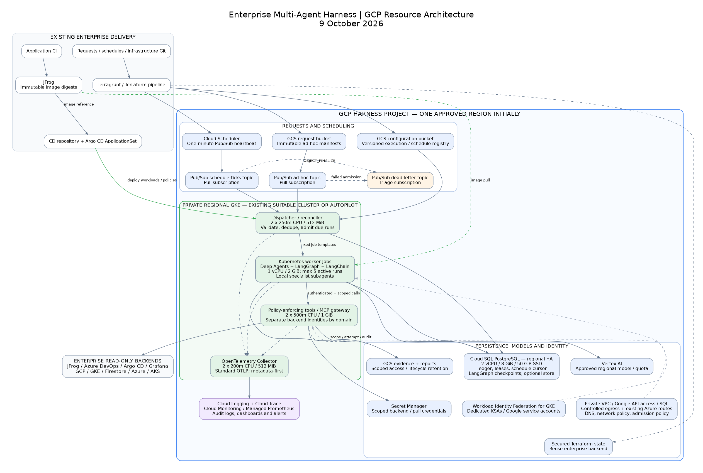

# GCP architecture for the enterprise multi-agent harness

Research snapshot: 9 October 2026. This is a proposed architecture, not a deployed or load-tested system. The resource sizes are starting estimates.

Use the existing suitable regional GKE cluster if enterprise isolation and capacity policies permit it; otherwise use a dedicated regional Autopilot cluster. Deploy application images from JFrog through the existing Argo CD ApplicationSet/CD repository. Terragrunt/Terraform provisions GCP resources, IAM, request objects and the task/schedule registry. Argo CD owns Kubernetes workloads and policy manifests. Avoid assigning the same resource to both controllers.

## Resource diagram

The companion [Mermaid source](harness-gcp-architecture-2026-10-09.mmd) contains the full diagram. The [SVG diagram](harness-gcp-architecture-2026-10-09.svg) is suitable for sharing.

There are two event paths: immutable ad-hoc request objects generate Cloud Storage notifications; one Cloud Scheduler heartbeat wakes the dispatcher to admit due schedules. Both become durable run records and Kubernetes Jobs. No interactive user application, Entra user SSO or directory resolver is needed.

## Frameworks mapped to resources

Verified released packages: Deep Agents **0.7.23**, LangChain **1.4.4**, LangGraph **1.2.14**, `langgraph-checkpoint-postgres` **3.1.2**, and `langchain-google-genai` **4.4.0**. Pin a complete compatible dependency lock, initially with Python 3.12. Deep Agents remains classified Beta; production confidence must come from integration, recovery, security and workload testing. The [framework research](framework-current-2026-10-09.md) provides release timestamps and official sources.

| Framework capability | Implementation and GCP resource |
|---|---|
| Deep Agents orchestration, specialist delegation and context management | One worker process in a Kubernetes Job. Local subagents have separate contexts, but share the process and workload identity. Separate pods only for a genuine security or scaling boundary. |
| Planning, skills and model-aware harness profiles | Reviewed prompts, skills and middleware in the immutable JFrog image; execution configuration references the image/prompt revision. Add planning middleware explicitly when wanted: current profiles do not universally enable it. |
| Per-run virtual filesystem | Default `StateBackend`, persisted with graph checkpoints. Bound its size. Keep temporary local files disposable. GCS is not a built-in Deep Agents filesystem backend. |
| Large raw evidence and final reports | Explicit upload/read/search tools against GCS, with immutable generation references. Avoid loading complete log archives into graph state. |
| LangGraph durable execution | Official `AsyncPostgresSaver` in Cloud SQL PostgreSQL. Start with synchronous durability at step boundaries. Replacement Jobs resume the same thread and pinned code/config. |
| Optional cross-run memory | `PostgresStore` in a separately authorized schema/namespace. Off initially. Namespace naming alone does not provide access isolation. |
| Optional semantic memory | PostgresStore with pgvector and an approved embedding model if a use case justifies it. No dedicated vector database initially. |
| LangChain model/tool integration | `create_agent`/middleware under Deep Agents. Use `ChatGoogleGenerativeAI` with Vertex AI, explicit project/region/model and ADC. `ChatVertexAI` is deprecated for new Gemini chat code. |
| Current MCP support | Native `langchain.mcp.MCPAdapter` arrived in LangChain 1.4; its API remains beta. The separate `langchain-mcp-adapters` package is another option. Select one after transport/auth/schema compatibility tests. HTTP MCP servers run behind the internal tool gateway; endpoints are deployment-controlled. |
| Current policy and reliability middleware | Model/tool limits, retries/fallback, summarization/context editing, PII handling and trace policies. Inject trusted dependencies and scope through `ToolRuntime`; keep secrets outside serializable graph state. Persist aggregate budgets across attempts. |
| Typed reports | Structured output plus application validation: findings, evidence references, source coverage, unavailable sources, completeness and recommendations. A valid schema alone does not establish correctness. |
| Tracing/evaluation | Standard OTel export to enterprise/GCP telemetry. Optional LangSmith SDK OTel-only instrumentor; no SaaS dependency. Offline evaluation datasets can run in application CI. |

Current Deep Agents also includes progressive skills/tool disclosure, DeltaChannel message checkpoint efficiency and optional remote asynchronous subagents. Remote subagents require an Agent Protocol server and their own authentication/policy; defer them initially. Preserve `DeepAgentState` behavior when extending state schemas.

The OSS libraries do **not** require Redis, a LangGraph HTTP server, GPUs, Filestore, Firestore or hosted LangSmith. The separately licensed LangSmith Agent Server is an alternative serving architecture with PostgreSQL, Redis and license requirements; it is not implicitly required by Deep Agents.

## Initial sizing and scaling

Assumed first workload: 10–50 investigations/day, at most five active runs, up to three simultaneous specialist/model calls per run, generally under 30 minutes. Change limits for measured workloads rather than treating these as vendor defaults.

| Resource | Initial allocation/configuration | Scaling approach |
|---|---|---|
| GCP project/region | Dedicated harness production project where possible; separate nonproduction trust boundary. One approved region close to existing systems and the selected model. | Separate projects/regions for stronger isolation or DR. Regional HA is not cross-region DR. |
| Regional GKE | Existing suitable cluster preferred; otherwise private regional Autopilot with Workload Identity Federation for GKE. Autopilot manages node sizing. | Autopilot scales from pod requests. With Standard instead: three `e2-standard-4` nodes total across three zones, autoscaling 3–9 total, is a starting envelope. Verify quota and allocatable capacity. |
| Dispatcher/reconciler | 2 replicas, each 250m CPU/512 MiB requested; 1 CPU/1 GiB limit. Bounded DB pool, leases and deterministic Job names. | Start fixed at 2 for availability. Increase when measured admission/reconciliation throughput requires it; queue metrics are more useful than CPU alone. |
| Worker Job | 1 vCPU/2 GiB requested; 2 vCPU/4 GiB limit; 2–5 GiB bounded ephemeral storage. Initial deadline 30 min, retry cap 2, finished Job TTL 24 h after evidence is persisted. | Admission limit 5 active runs; initially 3 specialist/model calls per run. Increase global concurrency only within DB, model and backend quotas. Native Jobs are not scaled with an HPA. |
| Tool/MCP gateway | 2 replicas per required security domain, each 500m CPU/1 GiB requested. Read-only tool registry and backend-specific limits. | HPA 2–6 from latency/in-flight requests plus CPU. Scale a slow connector separately where justified. If tools are initially in-process, equivalent identity/policy restrictions are still required. |
| OTel Collector | 2 replicas, each about 200m CPU/512 MiB requested, bounded export queues and batching. | Scale on dropped spans/export backlog. Flush worker exporters before Job exit. A managed enterprise collector may replace this component. |
| Cloud SQL PostgreSQL | Enterprise edition, regional HA, 2 vCPU/8 GiB RAM, 50 GiB SSD, storage auto-increase with an initial 200 GiB cap. Private IP. Automated backups/PITR, initially 7 days PITR. | Increase storage from growth forecasts; CPU/RAM from checkpoint latency/connections. Use pools: 2–4 connections/worker, bounded dispatcher/gateway pools; initial total connection target below 50. Read replicas do not solve write-heavy checkpoints. |
| SQL logical data | Separate control-plane ledger/schedule tables, checkpoint schemas by security domain, optional memory tables. | Retention/partitioning first; separate instances when authorization or workload isolation requires it. No Firestore ledger initially. |
| SQL connector/proxy, if required | Supported PostgreSQL connection/auth path with TLS and automatic IAM login. If using a proxy sidecar, initially about 100m CPU/128–256 MiB. | Cloud SQL Auth Proxy does not pool connections. A Job sidecar must terminate correctly; use supported native sidecar semantics or explicit shutdown. Add PgBouncer only when measured connection churn requires it. |
| Pub/Sub | Ad-hoc notification topic/subscription; schedule-heartbeat topic/subscription; dead-letter topic and triage subscription. Small references, not full log blobs. Initially 7-day message retention, retry backoff roughly 10–600 s, dead-letter attempts 5–10 where appropriate. | Managed capacity; control admission rather than allowing unlimited Job creation. Alert on backlog age and dead letters. DLQ counts are best effort, not an exact retry contract. |
| Cloud Scheduler | One `* * * * *` native Pub/Sub heartbeat in the same project as its topic. | One heartbeat can serve many schedules. Dispatcher owns schedule evaluation/cursors. Use UTC initially; declare and test timezone/DST semantics if local schedules are enabled. |
| GCS buckets | Separate request, configuration, evidence and report buckets; regional Standard, uniform bucket-level access, public access prevention. Version config/evidence where needed; notification only for ad-hoc request prefix. | Managed scaling. Start evidence 30-day and report 90-day retention, subject to corporate policy. Do not lifecycle-delete Terraform-managed request objects. |
| Secret Manager | One scoped secret per backend identity/security domain where federation is unavailable. Terraform manages metadata/references/IAM, not payload values. | Rotation/revocation and bounded runtime refresh. Prefer short-lived tokens/federation. |
| Terraform state | Reuse the secured enterprise remote state backend; otherwise provision a separate GCS state bucket with versioning and restricted pipeline access. | Request goals/parameters can appear in state even without secrets. Keep state outside runtime evidence/request permissions. |
| Vertex AI | Approved model, explicit location; ADC using worker identity. No inference GPU/node pool. | Token/QPS/concurrent-request quotas, measured quality, token budgets and tool fan-out govern throughput. Provisioned throughput only if justified by sustained load/SLOs. |
| Networking | Existing VPC/shared VPC, private GKE/SQL, Private Google Access or approved private API path; controlled NAT/proxy if internet egress is needed. Existing inter-cloud routing for private Azure endpoints. | Size pod/subnet ranges for autoscaling; adjust NAT capacity from connection metrics. PSC, new HA VPN and additional DNS zones are conditional, not mandatory duplicates of existing enterprise infrastructure. |
| Observability | Logging, Monitoring/Managed Prometheus, Cloud Trace/OTLP ingest, dashboards/alerts, audit-log configuration. | Sampling/retention and metadata-only export constrain cost. BigQuery log export is optional for longer audit analysis. |

Allow for Autopilot resource adjustment/admission rules. All sizes require a pilot with real evidence volumes, checkpoint growth and backend throttling. Do not raise worker concurrency because spare CPU exists while model/API quotas are saturated.

## Execution and recovery contracts

**Ad-hoc:** Terraform writes an immutable request object. Its notification contains bucket/name/generation. Fetch that exact generation, compute/verify a content hash, validate the manifest and copy the normalized request into the run ledger. Map the trusted source bucket/prefix to its permitted execution configurations; a request cannot authorize itself by asserting a repository or profile name. Use separate submission buckets/writer grants where authorization boundaries require them. Reject reuse of an ID with changed content. Transactionally persist the run and pending launch, then acknowledge Pub/Sub. A reconciler creates a deterministic Job and verifies existing Job identity after a create conflict.

Cloud Storage/Pub/Sub are at least once. A request ID is the logical idempotency key; a deliberate rerun gets a new ID. Keep compact admitted-ID/hash tombstones beyond the possible replay horizon, potentially indefinitely. Terraform may otherwise recreate objects after lifecycle deletion or drift. Use supported `PREVENT`/`ABANDON` deletion policy as appropriate, and retire requests deliberately rather than expiring still-managed objects.

**Scheduled:** Terraform publishes a versioned registry of schedule definitions/task templates. The dispatcher reconciles that registry into SQL using a canonical manifest generation/revision and compare-and-set update; an older import cannot overwrite a newer disable. A configuration change becomes effective after successful reconciliation. The single Scheduler heartbeat is a wake-up, not a task or nominal execution timestamp. For each active schedule, admit an eligible nominal occurrence and advance its cursor atomically with `UNIQUE(schedule_id, nominal_due_utc)`, against the active SQL registry revision in that same transaction. Pin the template/config generation and image digest on admission. Duplicate ticks do not create duplicate occurrences. An old tick never reinstates an old or disabled configuration. Read/apply the active registry before admission and alert on configuration reconciliation failures.

Set an explicit grace period and missed-run policy. Initially skip missed old occurrences, admit at most the latest eligible occurrence and forbid overlap for the same schedule. Disabling a deployed schedule prevents future admissions; an active run needs explicit cancellation. A cursor ledger makes the runtime the schedule authority, avoiding two independent cron interpreters.

**Recovery:** one stable LangGraph thread per logical run; leases/fencing govern attempt admission and gateway calls. Stock `AsyncPostgresSaver` does not enforce those fencing tokens. Checkpoint writes therefore require a tested exclusive-ownership mechanism, such as a per-thread database lock with writes bound to the owning session and immediate stop on loss of ownership, or a fencing-aware saver wrapper. Merely fencing the ledger is insufficient. Checkpoints do not restart Pods or arbitrate ownership; the reconciler does that. Checkpoint persistence is step-based: an unfinished model/tool call can repeat after failure. Persist scope, budgets, evidence references, attempt history, image/config version and ownership externally. Maintain old image/config availability for resumable runs; drain or explicitly migrate threads on upgrades.

## IAM, Kubernetes RBAC and database permissions

Use dedicated Kubernetes service accounts and, where needed for SQL/Entra compatibility, dedicated Google IAM service accounts. Link each KSA to its GSA through a narrowly scoped `roles/iam.workloadIdentityUser` binding on that GSA and the supported GKE annotation. Alternatively use direct federated KSA principals for services that support them. Do not grant runtime access to node service accounts or download GSA keys.

| Principal | Permissions and scope |
|---|---|
| Terraform infrastructure identity | Existing controlled provisioner; permissions only for managed resources. Relevant role families are Container administration, Pub/Sub administration, Cloud Scheduler administration, Cloud SQL administration, bucket administration, Secret Manager metadata administration, service-account/IAM management, logging/monitoring configuration, plus network/DNS permissions only in the appropriate host project. Use custom/conditional grants or delegated enterprise modules instead of Owner/Editor. API enablement/bootstrap and IAM grant authority are especially privileged and should remain in the existing controlled pipeline. |
| Request-registration identity | Create/read request objects in the dedicated bucket and update controlled configuration objects as required. Object creation alone does not permit overwrite/delete; provider refresh/list requirements must be accounted for. Avoid general bucket admin for request submission. Separate this capability from infrastructure administration where enterprise pipelines permit it. |
| Argo CD deployment identity | Access to the target cluster and restricted Kubernetes deployment permissions in allowed namespaces/AppProjects. Image-pull credentials are repository-read only. No runtime backend credentials for the controller. |
| Cloud Storage service agent | `roles/pubsub.publisher` on the ad-hoc notification topic. Notification setup additionally requires bucket notification administration in the provisioner. |
| Cloud Scheduler service agent | Retain `roles/cloudscheduler.serviceAgent` on its project; this authorizes native Pub/Sub delivery. Same-project topic required. No HTTP invocation, OIDC caller SA, `roles/run.invoker` or manually added token-creator role is needed here. Service-agent grants are platform-managed and are broader than an application topic binding. |
| Pub/Sub service agent | For dead-letter forwarding: `roles/pubsub.publisher` on the DLQ topic and `roles/pubsub.subscriber` on source subscriptions, as documented. Provision these explicitly where not already present. |
| Dispatcher GSA | `roles/pubsub.subscriber` on the two input subscriptions; `roles/storage.objectViewer` on request/config buckets; `roles/cloudsql.client` and `roles/cloudsql.instanceUser` for the selected SQL instance/project, with restrictions where supported. SQL control-plane role can write ledger/cursors, not checkpoint schema DDL. |
| Per-attempt grant issuer | Dedicated IAM service account with no backend access. Dispatcher gets a custom role containing `iam.serviceAccounts.signJwt` on that account to issue short-lived, gateway-audience grants bound to worker identity, run ID and fencing token. The gateway validates the signature and current ledger ownership. No project-wide Token Creator grant or downloaded signing key. |
| Dispatcher KSA | Namespace-scoped Job create/get/list/watch, bounded patch/delete for cancellation/cleanup, and read Pod/status metadata as needed. No secrets read, Pod exec, role-binding creation or general deployment administration. Admission policy must enforce image digest, permitted worker service account, commands/volumes and restricted Pod security. Job creation itself can otherwise impersonate any namespace SA or mount secrets. |
| Worker GSA | Vertex prediction permissions (`roles/aiplatform.user` is a convenient baseline but broader than prediction; prefer a tested custom inference role when available), Cloud SQL connection/IAM login, and create/read permissions only on its permitted evidence/report paths. No Pub/Sub admin, secret access or backend write roles. |
| Worker KSA | No Kubernetes API RBAC initially. Disable unnecessary Kubernetes API token mounting; use the supported GKE workload identity path. Call the internal tool gateway with authenticated workload identity. |
| Tool-gateway GSA(s) | `roles/secretmanager.secretAccessor` on exact required secrets; explicit read permissions for backend resources; scoped GCS object creation/read if the gateway handles evidence. SQL role reads immutable admitted scope/ownership and writes trusted append-only tool audit events if used. No infrastructure administration. Separate identities by production/nonproduction and sensitive-data domains. |
| SQL migration identity | Cloud SQL connection/login plus controlled schema setup/migrations. Workers use only required DML. Run `checkpointer.setup()` through this migration step. Fix checkpoint schema/search path and enable `LANGGRAPH_STRICT_MSGPACK=true` or a tested explicit type allowlist. |
| Telemetry exporter / node collection | Trace exporter: `roles/telemetry.tracesWriter` for current native OTLP trace ingest, or documented `roles/telemetry.writer` where required by the chosen signal pipeline; metrics `roles/monitoring.metricWriter`; logs `roles/logging.logWriter`. Prefer collector-only export credentials. Use the supported GKE node service-account role such as `roles/container.defaultNodeServiceAccount`; do not give nodes backend access. |
| Operations/report readers | Existing enterprise identities get appropriately scoped `roles/logging.viewer`, `roles/monitoring.viewer`, `roles/cloudtrace.user` and report-bucket `roles/storage.objectViewer` as needed. Reading evidence/checkpoints is separate from reading dashboards. Logging Data Access records may require `roles/logging.privateLogViewer`. |

Cloud SQL IAM authentication does not grant SQL table access. Explicit database roles/grants are still required. Standard checkpointer tables are not inherently tenant-isolated: use separate schemas/databases/SQL users per security domain, or a custom tested tenant-aware saver. A shared superuser connection defeats that boundary.

Infrastructure/API prerequisites typically include Container, Compute, Pub/Sub, Storage, Cloud Scheduler, Cloud SQL Admin, Service Networking for private services access, Secret Manager, IAM/STS/IAM Credentials as needed, Vertex AI, Logging, Monitoring and the selected Trace/Telemetry ingest APIs. Optional CMEK adds key administration and service-agent encrypt/decrypt grants. Optional Shared VPC requires host-project permissions; do not assume the service-project provisioner administers the host network. The [IAM research](gcp-iam-review-2026-10-09.md) lists exact provisioner role names and conditional networking/bootstrap grants.

## Backend-specific read authorization

The tool gateway is the authorization boundary: a model chooses a registered operation and parameters, never arbitrary URLs, credentials, image names or service accounts. It validates caller identity and a dispatcher-issued per-attempt grant bound to that identity, run ID and fencing token against the ledger, then applies immutable scope intersected with current gateway policy, operation allowlist, resource constraints and budget. Keep the grant outside model inputs and serialized checkpoints. Workers sharing an environment GSA cannot prove ownership simply by supplying a run ID. HTTP method alone does not establish read-only semantics: some queries use POST and some APIs expose unsafe GET actions.

| Backend | Initial permission approach |
|---|---|
| GCP resource inventory | Custom read role with only required `get/list` operations and resource scope. Use predefined viewer roles only after checking their breadth. |
| Target GKE clusters | Cluster metadata access (e.g. `roles/container.clusterViewer`) plus separately configured Kubernetes read RBAC for permitted namespaces/resources. Explicit `pods/log` only where approved; no secrets, exec or port-forward. |
| Firestore | `roles/datastore.viewer` or narrower custom read permissions at the supported database/project boundary. Gateway enforces collection/document restrictions when IAM cannot express the desired scope. |
| Azure/AKS | Entra workload federation from a dedicated GSA to a dedicated application, then Azure Reader/required custom resource roles and AKS namespace read authorization. Authentication and resource authorization are separate. |
| Azure DevOps | Application identity admitted to the organization/projects, with only required code/build/release read permissions. Azure Reader does not grant ADO access. Confirm API support for the chosen service-principal authentication; use controlled scoped token fallback where necessary. |
| JFrog | Read-only repository/project token, or supported configured token exchange. Runtime data-query credentials and image-pull credentials should be separate. |
| Argo CD | Restricted project-role/API account with required application/project read permissions; no sync, delete, exec or configuration writes. |
| Grafana/log stores | Viewer/service-account scope and explicit datasource/log-backend query authorization. Grafana authentication alone does not grant access to every underlying datasource. |

Entra WIF, when needed, belongs to backend workload access and grants no directory rights by itself. No `Directory.Read.All`, user credential forwarding or corporate directory synchronization is required.

Deep Agents `tools=` is additive, not an allowlist that removes defaults. Explicitly omit shell/execute and unnecessary built-ins; use a non-shell backend. Filesystem rules can be replaced by subagents or bypassed by direct backend operations and are not an enterprise security boundary. Gateways must continue to enforce scope even if retrieved logs/repository content contain hostile instructions. MCP client-to-server authentication is separate from server-to-backend authentication.

## Networking and secrets

Private GKE and private Cloud SQL; allow worker egress only to required Google APIs, SQL, the tool gateway and telemetry. Gateway egress reaches approved enterprise systems through existing private routing or controlled HTTPS egress. Use Kubernetes NetworkPolicy, private DNS and firewall/proxy rules. Existing JFrog requires kubelet/node image-pull reachability; worker network policies alone do not govern that path.

Google API access should follow existing Private Google Access/PSC and VPC Service Controls policy where the selected model/API supports it. Verify region availability and data residency: selecting a region is not a substitute for checking every external backend/model endpoint. Add Azure connectivity only if it is missing; private AKS endpoints require appropriate routing and DNS.

Cloud Run/Artifact Registry are not baseline resources here. The existing JFrog image path remains suitable for GKE. Use repository-scoped pull credentials or a supported approved registry federation mechanism; GKE WIF does not automatically authenticate kubelet pulls to private JFrog.

Secrets are injected into trusted credential clients at runtime and are never included in prompts, graph state, tool results, traces or Terraform state. Certificate/federation flows obtain short-lived backend tokens; scoped service-token fallback stays in Secret Manager with rotation/revocation. Do not configure a generic shell that can read the gateway environment.

## Observability and evidence

Use Cloud Logging for structured stdout/platform logs, Cloud Monitoring/Managed Service for Prometheus for metrics, and OTel to Cloud Trace or the existing corporate trace backend. Standard OTLP is preferred over adding deprecated Google-specific exporters; the latest official Google examples show native OTLP ingest and current telemetry IAM roles. Avoid exporting the same metrics/logs through two pipelines.

Correlate every signal with request ID, schedule/nominal occurrence, run/thread ID, attempt/fencing token, Job/pod, agent/graph node, tool/backend/resource, model and image/config hash. Trusted code emits authorization and tool audit events; generated agent prose is not an audit log.

| View | Metrics and initial actionable alerts |
|---|---|
| Admission/scheduling | Request acceptance/rejection/deduplication, configuration import errors, due occurrence delay, skipped/overlapping schedules, Pub/Sub oldest age and DLQ depth. Alert on any DLQ message, recurring invalid manifest, ad-hoc queue age >10 min or normal due delay >2 min. |
| Execution/recovery | Run status/completeness/duration, active/backlogged runs, retry/resume counts, stale leases, launch failures, OOM/deadline exits and abandoned runs. Alert on expired lease or repeated launch/resume failure. |
| Models | Calls/latency/tokens by run/model, context size/summarization, quota errors, rate limits and estimated token cost. Alert on provider throttling and budget exhaustion. Billing budgets alert; they are not a hard spend stop. |
| Tools/backends | Operation/resource decision, denials, error/timeout/latency, backend QPS/rate-limit responses, secret refresh failures and evidence volume. Alert on authentication failure, unexpected denied capability and sustained throttling. |
| Persistence/platform | DB CPU/memory/storage/connections/checkpoint latency, backup/PITR status, GKE health, collector dropped spans/export queue and GCS write failures. Start storage/connection warnings around 70–80% of configured limits. |
| Quality | Evidence coverage, unavailable sources, incomplete reports, unsupported requests, human-reviewed regression outcomes. Track quality separately from availability and schema validity. |

Operational traces default to metadata, timings and counts; prompts/tool payloads can contain corporate code, secrets, logs and personal information. Redact before model/export where required and explicitly configure payload omission. Evidence, checkpoints and reports get separate access and retention. LangChain PII middleware does not automatically sanitize every custom span. Keep request/run identifiers in logs and traces, not high-cardinality metric labels. Retain evidence and concise findings; hidden model chain-of-thought is not an audit requirement.

Starting retention candidates: operational logs/traces 30 days, raw evidence 30 days, reports 90 days, detailed checkpoints 30 days after completion and audit metadata 365 days. Keep compact dedupe tombstones longer than the replay horizon. Implement checkpoint cleanup explicitly; PostgresStore TTL also needs a running sweeper. Obtain corporate retention requirements before production. Enable relevant Cloud Audit Logs Data Access categories selectively and estimate their cost.

Existing Grafana can consume the approved GCP metric backend with read-only credentials. Optional LangSmith offers agent-centric trace/evaluation UX if an approved deployment exists; self-hosted LangSmith is a separate operational/licensing decision, not necessary to observe this harness.

## Provisioning and validation boundaries

Terraform modules: project/API/IAM prerequisites; networking/private SQL; GKE platform when not existing; SQL databases/users; storage/notifications; Pub/Sub/DLQ; Scheduler heartbeat; secrets metadata; observability; task/schedule registry and immutable request objects. Argo CD: dispatcher, worker templates, gateways, telemetry configuration, service accounts, RBAC, admission policies, quotas and network policies. Keep secrets outside Git and normal Terraform payload/state.

Before production, verify real workload-federated tokens and least-privilege backend reads, default-tool removal and hostile-input denial, exact generation/hash admission, duplicate/replay behavior, concurrent Job ownership, process-kill resume, image/config compatibility, SQL failover/PITR, secret rotation, observability redaction/export flushing and measured resource/model quotas. This document verifies current source capabilities, not those deployment outcomes.

## Principal sources

- [Deep Agents released source](https://github.com/langchain-ai/deepagents/blob/deepagents%3D%3D0.7.23/libs/deepagents/deepagents/graph.py) and [LangChain released MCP adapter](https://github.com/langchain-ai/langchain/blob/langchain%3D%3D1.4.4/libs/langchain/langchain/mcp/adapter.py).
- [LangGraph persistence](https://docs.langchain.com/oss/python/langgraph/persistence) and [official Postgres checkpointer](https://github.com/langchain-ai/langgraph/tree/main/libs/checkpoint-postgres).
- [Current Google GenAI integration](https://docs.langchain.com/oss/python/integrations/chat/google_generative_ai).
- [Storage notification resource and publisher example](https://github.com/hashicorp/terraform-provider-google/blob/main/website/docs/r/storage_notification.html.markdown), [object deletion policy](https://github.com/hashicorp/terraform-provider-google/blob/main/website/docs/r/storage_bucket_object.html.markdown), and [Pub/Sub retry/dead-letter configuration](https://github.com/hashicorp/terraform-provider-google/blob/main/website/docs/r/pubsub_subscription.html.markdown).
- [Cloud Scheduler target API](https://github.com/googleapis/googleapis/blob/master/google/cloud/scheduler/v1/target.proto) and [Terraform Scheduler resource](https://github.com/hashicorp/terraform-provider-google/blob/main/website/docs/r/cloud_scheduler_job.html.markdown).
- [GKE cluster resource](https://github.com/hashicorp/terraform-provider-google/blob/main/website/docs/r/container_cluster.html.markdown), [Cloud SQL instance configuration](https://github.com/hashicorp/terraform-provider-google/blob/main/website/docs/r/sql_database_instance.html.markdown), and [SQL IAM users](https://github.com/hashicorp/terraform-provider-google/blob/main/website/docs/r/sql_user.html.markdown).
- [LangSmith OTel alternate-provider support](https://docs.langchain.com/langsmith/trace-with-opentelemetry) and [optional standalone Agent Server requirements](https://docs.langchain.com/langsmith/deploy-standalone-server).
- [Google native OTLP migration](https://github.com/GoogleCloudPlatform/opentelemetry-operations-python/blob/main/MIGRATION.md), [current LangGraph telemetry sample](https://github.com/GoogleCloudPlatform/opentelemetry-samples/blob/main/python/langgraph-sql-agent/README.md), and [native GKE trace writer role example](https://github.com/GoogleCloudPlatform/opentelemetry-samples/blob/main/java/otlp-spring/README.md).
- [IAM Credentials signing API](https://github.com/googleapis/googleapis/blob/master/google/iam/credentials/v1/iamcredentials.proto) for application-issued per-attempt grants.

Research source reports contain more specific IAM/observability links. Some public documentation domains were inaccessible from the research environment; released packages and official GitHub source/docs were used where available. No production connectivity, load or model-quality testing was performed.
