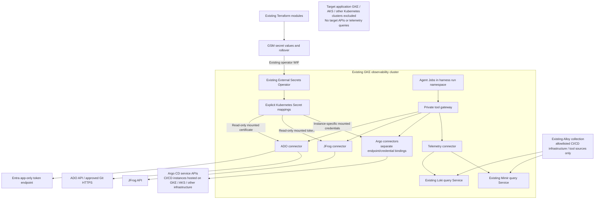

# Initial scope using the existing enterprise infrastructure

This scope adopts the user's clarifications on 11 October 2026 and is the authoritative phase-1 design. It supersedes the earlier connector-side GSM fetch, Google-to-Entra federation for ADO, Grafana-query, dedicated-cluster placement and five-concurrent-run proposals for the initial implementation. Infrastructure has not been deployed or modified.

## Investigation boundary

Investigations cover the enterprise CI/CD infrastructure and tools: ADO CI, JFrog, the separate Argo CD service instances, the infrastructure hosting those services and the existing observability/collection stack. This includes approved infrastructure telemetry from the GKE hosting clusters and the AKS clusters hosting Argo CD for Azure CD.

Target GKE, AKS and other Kubernetes clusters where Argo CD deploys user applications are **outside the investigation scope**. The harness does not query their APIs, application-workload logs, metrics, events or audit data, even if that data happens to be present in the shared Loki/Mimir installation. Argo CD API reads may return the controller's application configuration, destination identifiers and reported sync/health status as CI/CD evidence; they do not authorize querying the destination cluster. Target-cluster exclusion is a deliberate product boundary, not a missing collection requirement.

Maintain a reviewed allowlist of CI/CD source clusters and infrastructure components/namespaces using the actual Alloy labels and tenant configuration. Enforce it in every telemetry query and discovery operation. A shared tenant or network location alone does not enforce this boundary. Reject unknown or unmapped sources; do not fall back to unrestricted queries.

## Phase 1 access

| Backend | Included capability | Authentication/delivery |
|---|---|---|
| Azure DevOps | Read project/build/timeline/log/artifact metadata and approved Git content | Existing SP certificate from TF → GSM → ESO → connector Secret. Certificate-signed client assertion obtains ADO access tokens. |
| JFrog | Read approved artifact metadata, build information and bounded searches | Existing token delivered through TF/GSM/ESO. |
| Multiple Argo CD instances | Read permitted controller-reported application health, sync state, revisions and controller diagnostics | Explicit endpoint and separate credential binding for each instance; no target-cluster reads or target resource/log proxy operations. |
| Loki | Bounded read-only LogQL queries for approved CI/CD infrastructure/tool sources only | Existing internal Service endpoint; no additional backend credential assumed. |
| Mimir | Bounded read-only PromQL queries for approved CI/CD infrastructure/tool sources only | Existing internal Service endpoint; no additional backend credential assumed. |
| Grafana | Deferred; optional dashboard, annotation or Grafana-managed alert information | No Grafana credential/connector initially. |
| GCP/Azure infrastructure APIs | Deferred | No investigation cloud-viewer roles initially. |
| Target GKE/AKS/other Kubernetes application clusters | Outside the investigation scope | No target-cluster credentials, roles, API adapters or telemetry queries. |

GCP hosting permissions remain for the selected model service, checkpoint database, request messaging and evidence storage. Deferring cloud infrastructure investigations does not remove the service access needed to operate the harness itself. Runtime Job control in the harness namespace is likewise separate from interrogating target clusters.

## Diagram

The [PNG](harness-phase1-scope-2026-10-11.png) and [SVG](harness-phase1-scope-2026-10-11.svg) are shareable versions. Editable sources: [Mermaid](harness-phase1-scope-2026-10-11.mmd) and [Graphviz](harness-phase1-scope-2026-10-11.dot).



The request/schedule admission, SQL run ledger/checkpoints and evidence/report storage from the [baseline architecture](harness-gcp-architecture-2026-10-09.md) remain applicable. This diagram concentrates on the revised tool layer; target application clusters have no access path from it.

## Execution and deployment retained from the baseline

CI builds the harness image into JFrog; the CD repository and existing Argo CD ApplicationSet deploy it to the existing observability GKE cluster. Terraform/Terragrunt manages GCP resources, task/schedule configuration and credential values through the established enterprise modules. No interactive harness UI, user credentials or directory lookup is required.

For ad-hoc work, Terraform creates an immutable GCS request object; its finalize notification goes to Pub/Sub. The dispatcher validates the exact object generation/hash, authorizes the request against its deployed CI/CD-only scope, durably admits it in SQL and creates the worker Job. Updating a Pub/Sub topic does not itself submit a task. For schedules, Terraform publishes schedule configuration; one Cloud Scheduler Pub/Sub heartbeat wakes the dispatcher, which admits due occurrences from the current SQL schedule registry. CI/CD registers configuration and requests; the deployed runtime executes the investigations independently.

Each worker Job runs the parent Deep Agent and bounded local specialist agents on LangGraph/LangChain, using Vertex AI, Cloud SQL PostgreSQL checkpoints and GCS evidence/reports. Local subagents share the workload identity; they are not separate security boundaries. Start with two active Jobs at approximately 1 vCPU/2 GiB each and scale only after measuring shared-cluster headroom and backend/model/query budgets. Cross-run memory is optional and initially disabled; per-run context/checkpoints remain required. See the [framework review](framework-current-2026-10-09.md) for the framework capabilities.

## Credential delivery and rollover

Reuse the existing corporate Terraform modules as the credential producer/rollover mechanism. ESO is the GSM reader; connector Pods consume only their explicit mounted Kubernetes Secrets. No new GSM client, CSI add-on, secret-fetch controller or independent rotation service is required. Agent Jobs and the gateway do not mount backend credentials.

ADO needs certificate private-key material, in a supported PEM/PFX form, and any PFX password. The public certificate is registered on the Entra application. Tenant/client IDs are ordinary configuration. Python Azure Identity `CertificateCredential` or MSAL constructs a signed app assertion, requests `https://app.vssps.visualstudio.com/.default` and caches the returned token. The SP still needs the proper ADO organization membership/access level and project/repository/build permissions. It does not need Azure subscription Reader or Graph directory permissions merely to call ADO. This is certificate authentication, not Google-to-Entra WIF.

For each Argo instance maintain a reviewed record with logical instance ID, responsibility, endpoint, allowed projects/applications and exact credential Secret. Different instances must not automatically share tokens. Prefer the existing approved read-only machine-token form; any existing automation account/session mechanism is explicit per instance and remains noninteractive. Where distinct responsibilities form security boundaries, use separate connector deployments and mounted credentials. Restrict named API operations as well as permissions: exclude application log/resource proxy routes that retrieve data from target clusters, and exclude refresh/sync/write actions.

Credential lifecycle is:

```text
TF updates the approved GSM source
  → ESO refreshes the Kubernetes Secret
  → kubelet updates the mounted files
  → connector reloads the token or rebuilds certificate credential/client
  → new credential uptake is verified
  → old backend credential can be retired after overlap
```

Use the existing version-selection convention. Numeric pins require reference updates; latest or a promoted alias can follow TF changes when that is the established pattern. Configure a periodic ESO refresh that matches rollover needs. Normal Secret volumes update eventually; environment variables and subPath mounts do not hot-update.

ADO `CertificateCredential` reads its key at construction, so a file update alone does not reload the existing object. Implement safe credential/client reconstruction on file change, or reuse the approved connector-rollout mechanism. JFrog and Argo clients must also replace cached authentication headers. Retain overlap through ESO refresh, kubelet propagation, client reload and in-flight requests. Removing a GSM version does not revoke cached backend credentials or issued access tokens.

## Runtime and secret permissions

- ESO retains its existing WIF identity and permitted GSM reads; add exact-secret grants only where needed for these mappings. Connectors need no GSM payload access for ESO-delivered credentials.
- Connector KSAs need no Kubernetes `secrets.get/list/watch` merely to mount a specified Secret. Kubelet delivers the volume. Files remain outside agent contexts/checkpoints/tools.
- Separate the agent Job namespace from namespaces holding connector Secrets. Job creation can otherwise permit mounting Secrets in the creator's namespace. Keep existing workload admission restrictions.
- Restrict ExternalSecret/store modifications to reviewed deployment identities. A namespaced SecretStore does not narrow a shared ESO controller's Google permissions; explicit remoteRef/store/target mappings and appropriate admission/RBAC matter.
- Keep only the GSA/WIF mappings needed by an actual runtime service function, such as SQL IAM or outgoing Google service-token authentication. A mounted-token connector does not need a GSA solely for its backend credential.

## Direct Loki and Mimir queries

Grafana is unnecessary for raw log and metric analysis. Loki is the log source, Mimir the metric source; Grafana is another consumer/UI. Prefer existing internal query frontend/gateway Service DNS, using the existing deployment's protocol and configured API prefix. No new public ingress or backend OAuth/mTLS layer is required for the user's internal-only assumption.

Typical existing read paths:

- Loki logs: `GET /loki/api/v1/query_range` with a constrained LogQL expression.
- Mimir metrics: configured prefix, ordinarily `/prometheus/api/v1/query` or `/prometheus/api/v1/query_range`.

Allow only selected read method/path combinations. Mimir includes operational routes such as ingester flush; neither “internal endpoint” nor GET alone is a read-only guarantee. Block push/write/delete/admin routes in connector code.

If tenancy is enabled, set X-Scope-OrgID from trusted configuration and never from arbitrary agent input. Query tools use approved source aliases, fixed labels/tenants, controlled query templates and bounded time/range/result/scan cost. Start with short windows, limited simultaneous telemetry queries and server-side limits where already supported. A Loki result limit does not cap scanned bytes or prove complete collection.

NetworkPolicy restricts worker Pods from directly querying telemetry endpoints; only the trusted telemetry connector takes that path. Shared-cluster isolation includes namespace quotas, resource requests/limits and lower worker priority than observability services. Start around two concurrent investigations and raise this from measured headroom, rather than assuming the earlier five-run envelope fits this cluster. No duplicate Loki/Mimir/Grafana/Alloy stack is introduced.

## Coverage and observability

Maintain a reviewed source map from backend/Argo instance to CI/CD hosting cluster/environment, approved infrastructure namespaces/components, actual Alloy labels, Loki streams/Mimir series and expected freshness. Do not assume label names without inspecting existing collection configuration. Scope label/series discovery just as strictly as data queries. Distinguish a telemetry source/hosting cluster from an Argo deployment destination; destination labels do not grant access to that cluster.

Telemetry from AKS clusters hosting Argo CD is included only for approved enterprise pipeline infrastructure. Telemetry from Argo-managed application clusters is deliberately excluded. Argo application state is the controller's observed snapshot; reports must not claim independent target-cluster validation. Empty infrastructure logs can mean a quiet system, incomplete collection, stale ingestion or insufficient scope. Return collection timestamps, coverage of the included CI/CD sources, truncation and unavailable-source status in findings. List target application clusters as outside scope, not as missing evidence that should be collected.

Use existing Alloy/observability to ingest structured harness logs and metrics; add OTel export only to the approved supported pipeline. Monitor ESO sync freshness/errors, certificate expiry, connector reload success, backend 401/403, tool denials, telemetry query duration/scan volume/rate limits, queued runs and resource contention. Keep private keys, token values and authentication headers out of logs/traces/evidence/checkpoints.

## Source reviews

- [ESO and certificate security review](phase1-eso-security-2026-10-11.md): official ESO GCPSM WIF, ExternalSecret lifecycle and Azure CertificateCredential sources.
- [Direct Loki/Mimir access review](phase1-observability-access-2026-10-11.md): official API, tenancy, limits and source-coverage findings.

This is the revised first-stage design. No installed-version compatibility, ESO rollover, backend authentication or telemetry query was exercised against the enterprise infrastructure.
