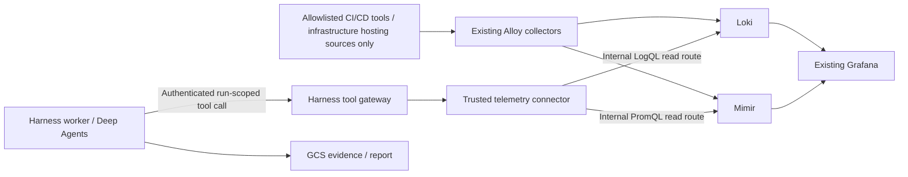

# Phase 1: existing Loki/Mimir access and shared-cluster protection

Reviewed 2026-10-11 against current official Grafana source documentation. This is an architecture recommendation; no shared observability stack, credentials or deployment were changed. The [phase-1 scope](harness-phase1-scope-2026-10-11.md) governs these recommendations.

## Current assumptions from the user

- The harness will run in the same GKE cluster as the existing observability suite.
- Existing Alloy collectors already send the collected Argo CD, JFrog and infrastructure-cluster logs/metrics to central Loki and Mimir, including the GKE/AKS CI/CD hosting infrastructure that has actually been configured.
- Investigations cover enterprise CI/CD tools and infrastructure only. Target GKE/AKS/other Kubernetes clusters receiving user application deployments through Argo CD are excluded, even when their telemetry is present centrally. An allowed hosting cluster also does not authorize unrelated application namespaces/workloads.
- Loki/Mimir query endpoints are internal-only. Phase 1 may use their existing ClusterIP/read routes without adding backend OAuth/mTLS credentials.
- The harness retains its own authenticated, policy-enforcing tool gateway and fixed run scope; workers cannot directly bypass it to query Loki/Mimir.
- External Secrets Operator is the enterprise mechanism for materializing applicable Secret Manager secrets into Kubernetes. The Terraform/pipeline workflow manages the required secret lifecycle/rotation according to existing policy.
- Broad GCP/Azure infrastructure APIs are deferred. This does not remove IAM for the harness's own GCS/Pub/Sub/Cloud SQL/Vertex AI resources.
- No changes to the shared observability deployment are being made now. Recommendations below are consumer-side controls and items to verify with its current configuration.

## Do we need Grafana access?

No Grafana API credential is needed to read the underlying logs and metrics. Grafana is a client/UI for the same data; the harness should query Loki using LogQL and Mimir using PromQL through their existing read/query routes.

Grafana access is optional for a later goal that actually needs dashboard JSON/panel definitions, Grafana-managed alert definitions, annotations, folders or dashboard links resolved by UID. Grafana service-account tokens authorize Grafana HTTP APIs and do not automatically authorize direct Loki/Mimir endpoints. Reuse dashboard URLs in reports without giving the harness a Grafana credential where these can be derived from approved configuration.

## Phase 1 backend matrix

| Backend | Initial use | Route/permission boundary | What it cannot establish by itself |
|---|---|---|---|
| Loki | Required: observed logs for allowed environments/components | Existing internal read/query route; fixed configured tenant if enabled; exact read-route allowlist plus label/resource/time policy | Current authoritative Argo manifests, artifact existence, Kubernetes object contents, or completeness of logs that were never collected/retained |
| Mimir | Required: observed health/performance/state metrics | Existing internal query-frontend route; fixed configured tenant if enabled; scoped PromQL/metadata requests | Live Kubernetes/GCP/Azure state beyond the exported samples; application health from `up` alone; anything absent from the scrape/export configuration |
| Grafana | Optional, initially no credential | Later scoped service-account permissions if a dashboard/alert-definition task requires them | A substitute for Loki/Mimir tenant or backend permissions |
| Alloy | Existing ingestion/collection path; no tool-facing control adapter | Existing collector identity/configuration stays separate; harness exposes logs/metrics using compatible discovery labels if supported | A complete semantic inventory simply because a collector is deployed |
| Argo CD API | Included phase-1 adapter for application configuration and controller-reported status/diagnostics; query only when needed | Separate existing read-only credential binding for each instance; no target workload log/resource proxy routes | Controller observations do not independently validate target cluster objects, logs or runtime health |
| JFrog API | Included phase-1 adapter for artifact/build/repository metadata | Existing repository-scoped token delivered by TF/GSM/ESO | Logs/metrics alone do not prove artifact existence, checksums, retention, permission state or all build metadata |
| Target application clusters: API and telemetry | Outside the investigation scope | No cluster identity, API adapter or telemetry query; dispatcher Job control remains confined to harness execution namespaces | Target health is not independently investigated; this is a deliberate scope boundary |
| ADO APIs/Git | Included phase-1 adapter; central coverage has not established all ADO data | Existing SP certificate via TF/GSM/ESO and approved ADO organization/project read permissions | CI run definitions, logs or repository history absent from the observability export |
| Broad GCP/Azure infrastructure APIs | Deferred | No general infrastructure discovery roles granted to workers | No inference that cloud inventory/configuration is complete from cluster telemetry |
| Harness GCP services | Required for platform operation | GCS object permissions, Pub/Sub subscriber, Cloud SQL client/IAM login, authorized Vertex model invocation; other narrow platform roles as designed | These rights do not imply read permission across unrelated GCP/Azure infrastructure |

Use included direct adapters when an investigation requires their authoritative data. Broader cloud infrastructure APIs remain deferred; target application clusters are excluded. Reports must distinguish centrally observed CI/CD telemetry, direct tool API results and controller-reported deployment status.

## Read flow and boundaries

The trusted tool-layer deployment configuration owns the backend host/port/base path and tenant. An agent supplies typed query intent and approved parameters, not an arbitrary URL, tenant header, HTTP method, credential or upstream path. NetworkPolicy allows only the trusted telemetry connector pods to reach existing read services and prevents worker pods from direct query access. Policies must rely on admission-protected pod/namespace labels and the cluster's supported enforcement mode; ordinary NetworkPolicy does not understand KSA identity by itself. The harness does not receive monitoring-admin, Alloy configuration, Loki distributor/compactor or Mimir write/ruler-admin access.

With the user's internal-only assumption, no new backend authentication gateway is a phase-1 prerequisite. Internal network reachability is the selected backend trust boundary. That should not be described as Google IAM authentication to Loki/Mimir: GCP IAM does not govern their ordinary HTTP query APIs.

Loki's `auth_enabled: true` and Mimir's multitenancy flag primarily require a tenant selector. `X-Scope-OrgID` is not proof of workload identity. If tenancy is enabled, trusted gateway configuration supplies a fixed allowed tenant; the model cannot submit a different tenant or `tenant-a|tenant-b` federation string. If multitenancy is disabled, do not assume a tenant header creates isolation. Do not expose raw query service ports to worker pods through an alternative route.

If access becomes external/shared with untrusted clients later, add the supported authentication layer (existing reverse proxy/enterprise gateway or enterprise product access policy), map identity to permitted tenant, and overwrite any incoming tenant selector. Current Loki supports optional native transport mTLS but still does not derive tenant permission from the client certificate automatically. Such a change is outside the current phase-1 prerequisite.

## Established read API routes

Use the service URLs/read routes already configured in this deployment; Helm service names, ports and routing prefixes vary.

| Backend | Route | Purpose |
|---|---|---|
| Loki | `GET /loki/api/v1/query_range` | Time-bounded raw log reads and range LogQL metric queries |
| Loki | `GET /loki/api/v1/query` | Instant **metric-type** LogQL; current docs reject instant raw-log queries |
| Loki | `GET /loki/api/v1/labels` | Scoped label-name discovery, with `query`, `start`, `end` |
| Loki | `GET /loki/api/v1/label/{name}/values` | Scoped values discovery, with `query`, `start`, `end` |
| Loki | `GET,POST /loki/api/v1/series` | Optional bounded stream discovery with mandatory allowed `match[]` selectors |
| Mimir | `GET,POST <prometheus-prefix>/api/v1/query` | Instant PromQL |
| Mimir | `GET,POST <prometheus-prefix>/api/v1/query_range` | Time-bounded PromQL range with explicit `step` |
| Mimir | `GET,POST <prometheus-prefix>/api/v1/labels` | Scoped label discovery |
| Mimir | `GET <prometheus-prefix>/api/v1/label/{name}/values` | Scoped label values |
| Mimir | `GET,POST <prometheus-prefix>/api/v1/series` | Optional bounded series discovery |
| Mimir | `GET <prometheus-prefix>/api/v1/metadata` | Optional known-metric metadata; not an unbounded tenant-wide discovery default |

Mimir's default Prometheus prefix is `/prometheus`, configurable through `api.prometheus_http_prefix`; an existing gateway might rewrite it. Verify the installed route before coding the client. POST is acceptable for read query endpoints where documented; method alone does not determine mutability. In particular, Mimir documents `GET /ingester/flush`, so an indiscriminate `allow GET /...` policy is incorrect. Allow exact methods and paths, not all read-looking URLs.

Disable ingest, log deletion, ruler configuration, Alertmanager mutation, service debug/pprof/config/rings/shutdown and open-ended tailing APIs in the agent tool surface. Optional read alert/rule endpoints require a separate purpose and allowlist; they are not required just to investigate logs/metrics.

Current Mimir docs include new streaming `search/metric_names`, `search/label_names`, `search/label_values` endpoints. They are explicitly **experimental and disabled by default**. Use established query/labels/series APIs for the initial stable integration. Loki experimental query engines, patterns and other additional APIs are not necessary for phase 1.

## Query scope and evidence completeness

Scope every source selector to approved trusted ingestion labels, using the deployed topology mapping: actual CI/CD hosting/source cluster identity, provider/site, infrastructure namespace, service/component and Argo instance/project as available. Distinguish the source cluster from any deployment-destination label attached to Argo controller metrics. A destination identifier may appear in CI/CD evidence without granting permission to query that target cluster. Do not invent labels or assume every series has all of them. Verify the existing Alloy/external-label configuration and build a versioned adapter mapping from it. Reject unknown/unclassified source mappings.

For a generic query adapter, use a proper PromQL/LogQL parser and validate every vector/log selector and metadata `match[]` expression. Text replacement/regex prepending is not a safe scope enforcement mechanism. Another simpler initial approach is typed query builders or bounded approved query templates. Any arbitrary user-generated expression capability must be tested for unions, binary joins, subqueries, label manipulation, nested selectors and unscoped discovery. Deployed policy, not the prompt, decides allowable resource scope.

The tenant is only one boundary. In a shared tenant, enforce both the approved CI/CD hosting source and infrastructure component/namespace restrictions for queries, labels, label values, series and discovery. An approved cluster alone can also contain unrelated applications. Exclude target application cluster telemetry even when it shares the tenant. Prefer restrictive selectors plus typed builders to claiming the tenant inherently grants row/label-level authorization. Where an allowed data set cannot be expressed by trustworthy source labels, deny that query and report the limitation rather than falling back to broad collection.

The gateway records original requested interval, actual query interval, expression, collection time, response status/warnings, API route, query stats, returned result bounds, policy applied and evidence hash. Preserve `truncated/partial` information in the report. Backend lookback limits can silently trim a query window; do not assume a successful response covers the entire requested interval.

For Loki, `limit` caps returned log lines, not scan cost or completeness. Query a narrow scope/window, split windows when necessary and mark saturated results incomplete unless the collection strategy can demonstrate exhaustion. There is no generic offset-based log pagination to assume; duplicate equal timestamps and per-stream order need care. `interval` intentionally samples log results; use it only when the result is explicitly presented as a sample. `step` controls LogQL metrics, not raw-log pagination.

For Mimir, enforce aggregate-first queries, bounded series and a sensible step. A successful instant response's timestamp can be evaluation time, not source sample age. Use `timestamp(metric_selector)`/freshness expressions and expected-series inventory to evaluate actual source freshness. `up=1` means a scrape target was reachable, not that its underlying application or complete collection pipeline is healthy.

Verify coverage at onboarding with a small sample for every allowed component:

- Existing tenant, topology labels, known metric families/log streams, retention and configured drops/redactions.
- Last source sample/heartbeat and known scrape cadence/remote-write lag; Alloy forwarding failures and rejected samples if already observable.
- Whether approved infrastructure kube-state metrics, CI/CD component logs, Kubernetes events and audit logs are actually collected. These are distinct data sets; filter event/audit records to permitted infrastructure resources as well as source labels, or leave that source unavailable.
- Whether source identities and component/namespace filters reliably exclude target application clusters and unrelated application workloads. Do not request onboarding or coverage of application deployment clusters.
- Whether Argo/JFrog exporter versions expose the requested health/storage/sync data, and whether relevant log severity and timestamps were retained.

No matching logs may mean no event, a quiet component, dropped labels, missing collection, expired retention or an inaccessible scope. An absent metric may mean missing exporter coverage or stale series. Return “insufficient/missing evidence” when these cannot be distinguished.

## Shared GKE and query-capacity protections

The main new contention risks are worker bursts and expensive log/metric scans competing with the existing observability suite. Remote model inference does not consume local GPU capacity.

Proposed pilot settings, to be validated against current cluster headroom:

- Worker Job: 1 vCPU, 2 GiB RAM, bounded ephemeral storage, 30-minute deadline. Start at **two active Jobs**, then raise to five only after queue/query performance is measured.
- Dispatcher: two replicas at 250m CPU/512 MiB each. Tool gateway: two replicas at 500m CPU/1 GiB each if a separate gateway deployment is retained. These are sizing estimates, not new shared-suite reservations.
- A dedicated harness namespace with ResourceQuota/LimitRange, nonprivileged pods, no host namespaces/paths and fixed admitted worker images/service accounts/volumes. Worker KSA does not get general Kubernetes or observability-admin permissions.
- Workers use a lower PriorityClass than essential observability components. On supported existing Standard GKE, an optional tainted/labelled worker node pool that can scale 0–2/3 nodes limits resource interference; do not create/change such a pool until current headroom and operational policy justify it. Without a dedicated pool, enforce the initial hard concurrency/resource cap.
- Gateway initial total upstream concurrency of one Loki query plus one Mimir query, with a shared rate/burst budget rather than a separate cap in every gateway replica. A single split/sharded query can fan out into many backend tasks, so frontend limits and measured query stats also matter.
- Start log searches around 15–60 minutes and narrow resource selectors; expand deliberately up to an approved maximum such as 24 hours. Cap log lines (for example 1,000/request), response bytes and total run evidence. Treat limit saturation as partial evidence.
- Start metrics with aggregated queries, explicit `step` (for example at least 60 seconds for multi-hour trends), bounded returned series and total points. Result caps do not necessarily bound scan cost.
- Bounded backend timeout/retries; observe 429/Retry-After with jitter; reject budget-exhausting loop/query patterns. Do not multiply unbounded HTTP/framework/Job retries.

These are consumer controls and do not require changing shared Loki/Mimir configuration. Existing backend limits such as Loki `max_query_length`, `max_query_parallelism`, `max_entries_limit_per_query`, `max_query_bytes_read`, and Mimir `max_total_query_length`, `max_fetched_series_per_query`, `max_fetched_chunk_bytes_per_query`, `max_query_parallelism` can help **if already configured and supported by the installed version**. Do not assume defaults provide tight limits. Some Loki byte-scan enforcement depends on TSDB/query shape and does not cover every unfiltered log query.

Loki has an existing `X-Loki-Actor-Path` fairness mechanism since 2.9. If already enabled, the trusted gateway can use one stable harness actor path to avoid unfairly sharing a single actor queue. This is fairness, not authentication or a hard resource ceiling. Do not generate per-run actor identities to manufacture extra scheduling shares. It is optional and does not justify changing the shared stack now.

## Harness observability through the existing suite

Use structured stdout/stderr logs and a `/metrics` endpoint compatible with existing Alloy discovery. Confirm that the new harness namespace/pod labels and metrics endpoints are already included in collection; if not, identify the integration gap without assuming automatic coverage or editing the shared collector now.

Log correlation fields: `request_id`, `run_id`, `attempt`, `execution_class`, scheduled nominal occurrence, config/image digest, model, backend/tool, query ID, evidence object hash, duration, budget status and completion/partial outcome. Do not log secrets, authorization headers or hidden model reasoning. Keep raw enterprise payloads in scoped evidence storage, not unrestricted operational logs.

Metrics use bounded labels (environment, execution class, backend, outcome), with run/request IDs confined to logs. Monitor durable pending/active/finished runs, queue age, accepted-to-start latency, model tokens/estimated cost, tool query duration/errors/rate limits, backend returned/scanned bytes where available, query-limit exhaustion, missing/stale source coverage, checkpoint success/failure and worker OOM/timeouts.

Short-lived Job metrics may be missed between scrapes. Persist terminal counters/accounting in the run ledger and export them from the long-running dispatcher metrics endpoint. This avoids adding a Pushgateway or a second observability stack merely for finished Jobs. The same ledger remains authoritative when collection fails.

No new Grafana/Prometheus/Loki/Mimir deployment is needed. Detailed distributed trace storage is optional: logs can contain trace/span/run IDs without introducing Tempo/Cloud Trace as a phase-1 prerequisite. If an existing trace backend is available, instrument compatible OTel export without duplicating it. Full LangSmith content export remains optional and governed by enterprise data policy.

Alerting panels/rules can later use existing enterprise Grafana/alert routing, but creating/editing them is a deployment/provisioning responsibility, not a permission given to investigating agents.

## Secrets implications

Internal Loki/Mimir reads require no new backend OAuth/mTLS secret under the agreed trust assumption. The included ADO, JFrog and Argo CD adapters use their specific ESO-delivered credentials; optional additional model providers may still need scoped credentials.

ESO is the only intended sync controller, with its own narrow Secret Manager permissions. Backend credential volumes are mounted only into the corresponding connector Deployments; workers and the shared tool gateway do not mount them. They need not receive Google Secret Manager accessor solely because ESO materializes the secret. New Jobs pick up current versions; long-lived gateways must reload mounted credentials safely or restart when an applicable secret changes. Avoid assuming environment-variable or `subPath` mounts automatically refresh.

The Terraform/pipeline identity can manage approved secret versions and rotation as the user proposes; runtime agents receive no secret administration rights. Ordinary Terraform `secret_data` writes retain values in raw state even when marked sensitive; newer write-only fields can avoid that where the pinned modules/toolchain support them. Use the established enterprise state controls and rotation workflow.

## Official sources inspected

1. Current Loki API endpoints, LogQL range/instant distinction, labels/series, response limits and query stats: https://github.com/grafana/loki/blob/main/docs/sources/reference/loki-http-api.md
2. Loki application authentication versus optional native mTLS and trusted tenant-header overwrite: https://github.com/grafana/loki/blob/main/docs/sources/operations/authentication.md
3. Loki multitenancy and explicit federation behavior: https://github.com/grafana/loki/blob/main/docs/sources/operations/multi-tenancy.md
4. Loki actor query fairness, trusted header and limits: https://github.com/grafana/loki/blob/main/docs/sources/operations/query-fairness/_index.md
5. Loki query/scan limit implementation and caveats: https://github.com/grafana/loki/blob/main/pkg/validation/limits.go
6. Current Mimir query-frontend HTTP APIs, configurable prefixes, caching, and experimental streaming discovery: https://github.com/grafana/mimir/blob/main/docs/sources/mimir/references/http-api/_index.md
7. Mimir tenant selector and optional authenticating proxy requirements: https://github.com/grafana/mimir/blob/main/docs/sources/mimir/manage/secure/authentication-and-authorization.md
8. Mimir query limits/fetched-series/fetched-bytes implementation: https://github.com/grafana/mimir/blob/main/pkg/util/validation/limits.go
9. Alloy Loki write authentication and tenant configuration, illustrating ingestion credentials as a separate concern: https://github.com/grafana/alloy/blob/main/docs/sources/reference/components/loki/loki.write.md
10. Grafana service accounts authorize Grafana HTTP APIs; Enterprise granular permissions are distinct from direct telemetry backend auth: https://github.com/grafana/grafana/blob/main/docs/sources/administration/service-accounts/_index.md

These source documents describe current upstream capabilities. The installed enterprise versions/routes/limits and actual collection coverage must be verified; no assumption that main-branch experimental additions are installed was made.
