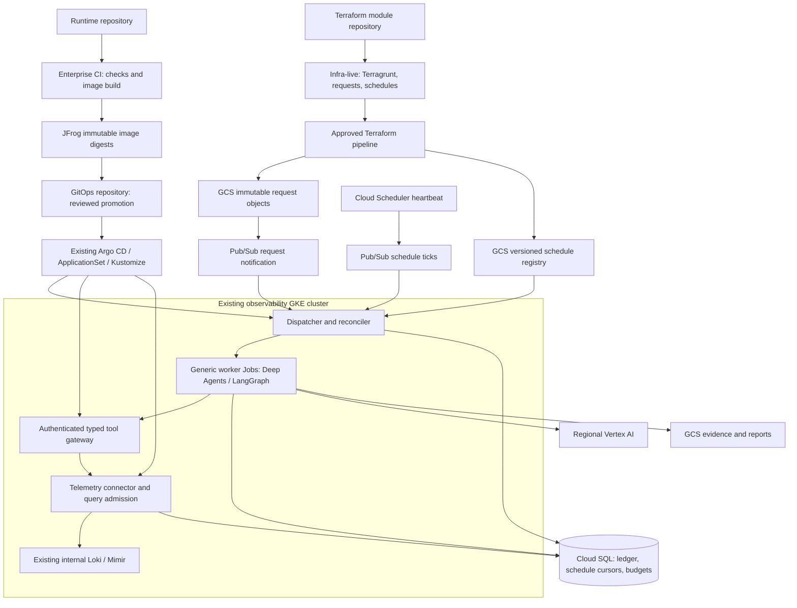

# Generic enterprise harness: detailed design and delivery plan

Design date: 18 October 2026. Status: reviewable design, not a deployment or an implementation-complete product. This design incorporates the user's answers on that date. It takes precedence over the October 9 broad architecture and incorporates the October 11 CI/CD-only scope and October 12 simplified service authentication.

## Read this design

| Document | Decisions and contracts |
|---|---|
| [Generic harness](generic-harness.md) | Runtime, extensibility, task lifecycle, agent features, context and memory, evidence and recovery |
| [Repositories and delivery](repositories-delivery.md) | Four repositories, Terraform/Terragrunt, Argo CD/ApplicationSet/Kustomize, promotion and ownership |
| [Infrastructure contracts](infrastructure-contracts.md) | Module inputs/outputs, managed service agents, state/registration rules, SQL bootstrap and deployment outputs |
| [Logs and metrics capability](logs-metrics-capability.md) | First capability pack, typed query interfaces, cardinality and cost protection, evidence quality, worked investigations |
| [Platform, security and operations](platform-security-operations.md) | GCP resources, identities, TLS, RBAC, observability, capacity, retention and failure handling |
| [Implementation plan](implementation-plan.md) | Sequenced work, acceptance criteria, version research, unresolved inputs and rollout gates |
| [Reference files](reference/README.md) | Renderable Kustomize illustration and non-deployable task/capability/source examples |

The proposed repository names are `harness-agent-framework`, `harness-terraform-modules`, `harness-infra-live`, and `harness-gitops`. Only the first repository currently exists in this work. The other names and layouts describe repositories to provision through the enterprise process.

## Confirmed decisions

- Generic multi-agent harness; capabilities and goals are extensions, not special cases in the orchestration kernel.
- Existing GKE observability cluster, Alloy, Loki, Mimir, ESO and corporate credential lifecycle are reused.
- Investigations cover enterprise CI/CD tools and their hosting infrastructure. Application deployment target GKE/AKS/other clusters and their telemetry are excluded, even if stored in the same backend.
- Read-only investigation; initially publish Markdown/JSON reports and evidence to GCS only. No human harness UI, SSO, directory resolver, interactive approvals or employee credentials.
- Ad-hoc work is registered by reviewed repository inputs through Terraform/Terragrunt and executes in the deployed runtime. Scheduled work is also configured in Git. CI/CD does not run investigations.
- Dedicated harness Terraform module repository and a separate live configuration repository. Argo CD consumes Kustomize from a separate GitOps repository. Existing CI builds images into JFrog.
- Vertex AI regional approved models; sanitized excerpts may be sent to them. Model and region are explicit configuration; no automatic global-endpoint fallback.
- First capability supports both targeted logs/metrics investigations and scheduled checks. It is a consumer of the existing observability setup; shared-stack changes need their owners' separate approval.
- Composable typed query builders and reviewed templates initially; raw PromQL/LogQL input is not exposed.
- Durable per-run context/checkpoints and reviewed Git runbooks. Automatic cross-run learning is disabled. Retained reports are evidence, not automatically trusted memory.
- Simplified authentication: worker GSA class to gateway; gateway GSA to connectors; fixed class policy. No per-Pod TokenReview/SQL authorization lookup. Run IDs are correlation/accounting metadata, not permission claims.

## Proposed defaults for review

| Topic | Proposal | Reason / limit |
|---|---|---|
| Environments | Dev and production; promote the same immutable artifacts | Additional staging is justified later by release volume or isolation policy |
| Placement | Separate namespace sets and GSAs per environment in the existing cluster | Shared-cluster failure domain remains; namespace separation is not independent disaster recovery |
| GCP resources | Separate environment projects where enterprise policy permits; otherwise separately scoped resources and IAM | Do not assume a new cluster or modify the existing platform's ownership |
| Availability | Production intake target 99.5% monthly, excluding agreed maintenance; scheduled health checks 24×7 | A proposed SLO, conditional on actual GKE/SQL/backend availability |
| Recovery | Target platform RTO 4 hours and SQL restore RPO at most 15 minutes | Objectives requiring a restore exercise; regional SQL HA is not regional disaster recovery |
| Pilot concurrency | Dev 1 Job, production 2 Jobs; one Loki and one Mimir query globally per environment, subject to a shared-backend aggregate cap | Dev and prod must not each independently consume the whole shared telemetry allowance |
| Reports / evidence / checkpoints | 90 / 30 / 30 days; audit metadata 365 days | Subject to enterprise data policy; raw backend retention is independently controlled |
| Automatic resume | Off in the first pilot until exclusive checkpoint ownership is proven | Checkpoints alone do not prevent concurrent stale writers |

The enterprise region, approved model IDs, exact repository names, internal PKI integration, installed Loki/Mimir/Argo versions, reliable ingestion labels, retention and current query limits are deployment inputs. Unknown values do not authorize broad discovery, arbitrary queries or platform changes.

## Architecture

Shareable [PNG](architecture.png) and [SVG](architecture.svg); editable [Mermaid](architecture.mmd) and [Graphviz](architecture.dot). The [investigation flow source](investigation-flow.mmd) shows the first capability's analysis loop.

The SQL arrows support execution, checkpoints and trusted service-wide budget coordination. They do not reintroduce per-run identity authorization. The generic tool architecture also accommodates the previously discussed ADO, JFrog and separate Argo connectors. Deploy them when their capability is enabled; the first telemetry capability does not need their credentials.

## Scope of this delivery

This branch supplies the design, repository contracts, examples and implementation backlog. It does not create the three new remote repositories, apply Terraform, deploy Kubernetes workloads, change observability configuration, select an unapproved model, or claim an enterprise integration test has passed.
