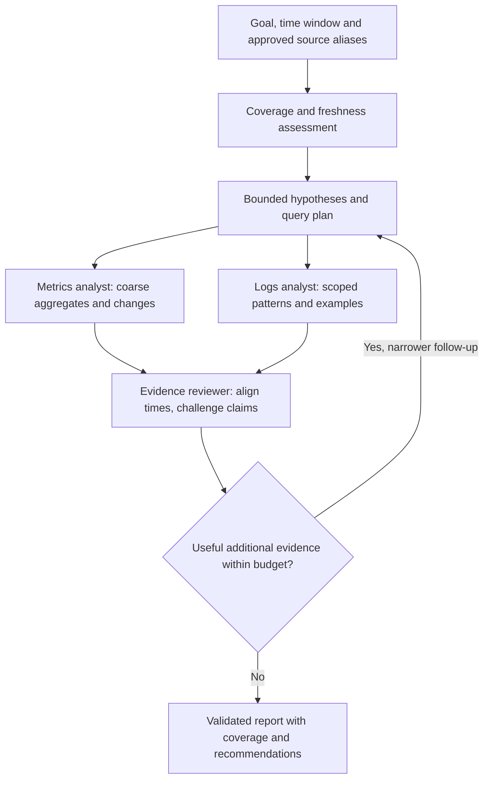

# First capability: CI/CD logs and metrics analysis

## Goals and scope

`pipeline-observability` supports a free-form investigation goal with typed scope/time parameters and scheduled health/anomaly checks. The harness remains generic; this pack supplies telemetry-specific skills, query operators, evidence interpretation and evaluations.

Use the existing internal Loki and Mimir query services. Grafana access, target application-cluster access and direct GCP/Azure investigation APIs are not required. CI/CD tool hosting infrastructure includes the AKS clusters hosting enterprise Argo CD instances; it does not include user application clusters managed by those instances.

The first release is a consumer. It cannot change scraping, Alloy labels, ingestion limits, recording rules, retention or backend configuration. It can diagnose suspected problems and recommend a separately reviewed observability-owner change. It cannot guarantee prevention of ingestion cardinality growth.

## Source inventory before querying

Each approved source alias has an environment, backend/endpoint alias, fixed tenant when needed, trusted ingestion source/hosting-cluster selectors, infrastructure component/namespace restrictions, approved metric families/log streams, timestamp semantics, expected collection cadence, retention and supported templates. Source selectors must use the actual existing labels, not assumed names such as `cluster` or `namespace`.

Differentiate ingestion/source identity from an Argo deployment destination label. A controller metric describing a destination is CI/CD evidence; it does not authorize querying that destination's telemetry. An approved cluster may also host unrelated workloads, so cluster membership alone is insufficient. Mixed audit/event streams need record-level resource filtering or remain unavailable.

Unknown source, untrusted label mapping or unscopable discovery fails closed. There is no fallback to `{job=~".*"}`, all tenants, all metric names or an entire cluster. Tenant headers are selected by deployed configuration; `X-Scope-OrgID` is not authentication.

Inventory review records which capabilities are actually observable. Metrics, logs, Kubernetes events and audit logs are separate data sets. Alloy being installed does not prove all are collected. Use known source heartbeats/exporter coverage rather than interpreting quiet logs as missing health data.

## Typed tool surface

| Tool | Representative arguments | Result and guardrails |
|---|---|---|
| `telemetry.describe_source` | Approved alias | Reviewed coverage/cadence/templates and freshness evidence; no broad backend scan |
| `metrics.query` | Source, template/operator plan, time interval, allowed grouping | Bounded numeric observations with sample/freshness metadata |
| `metrics.compare_windows` | Source, approved metric/template, two bounded windows | Deterministic change/ratio/baseline calculations; source age and comparable units |
| `logs.search` | Source, interval, literal filters, reviewed parser, severity, limit | Bounded sanitized lines, counts, direction, query statistics and truncation |
| `logs.summarize_patterns` | Source, interval, approved grouping/template | Bounded normalized message patterns/counts and representative lines |
| `evidence.read` | Authorized artifact reference, offset/length | Bounded prior evidence chunks with provenance; not arbitrary URL/filesystem reads |

`metrics.query` is not raw PromQL. A typed plan selects approved metric families/operators such as rate, change, percentile, aggregation and comparison. It specifies only allowlisted grouping labels and bounded parameters. `logs.search` similarly describes literals/parsers, not a free-form LogQL string. Trusted compiler code inserts scope, escapes values, calculates effective source ranges and emits the query. Reviewed templates handle operations outside the initial composable operator set. New operators/templates are versioned releases, not a request-time escape hatch.

Keep template IDs independent of incident goals: `counter_rate_by_component`, `histogram_percentile`, `error_log_patterns` can answer many questions. Actual metric names and units are mapped at onboarding. Do not assert that an exporter has a particular family without validating it. Mark unsupported questions as limited rather than inventing a query or metric.

Allow exact read routes: Loki `query_range` for raw logs, appropriate metric-type instant queries, and narrowly scoped metadata routes only where needed. Mimir uses its configured Prometheus prefix, often `/prometheus`. POST may implement a read query; GET is not automatically read-only. Exclude ingestion, deletion, ruler/admin/config/debug/tail operations.

## Cardinality: three independent controls

| Problem | Examples | What this consumer can do |
|---|---|---|
| Ingestion cardinality/churn | Metric label combinations; Loki stream explosion from request/build IDs or pod churn | Detect using existing bounded health metrics/observations; recommend owner changes; cannot alter ingestion |
| Query input/intermediate/output cardinality | Broad selectors, histogram buckets, regex expansion, parsing dynamic log labels, large joins | Constrain builders/templates, admission, windows, fetched data where supported, output and concurrency |
| Harness-generated cardinality | Per-run IDs, query text, artifact paths or error text added as Prometheus labels | Prevent directly through instrumentation schema and bounded label values |

Do not add build IDs, request IDs, SHAs, users, full URLs, raw messages or Pod UIDs to harness metric labels. Existing source labels may be high cardinality; select exact needed values instead of grouping/enumerating the entire label. For proposed ingestion fixes, prefer stable labels and structured metadata/log bodies, but leave implementation to owners.

An aggregate output does not imply a cheap input. `sum`, `count`, `topk`, a larger PromQL step and a Loki result `limit` can still scan a huge data set. A preflight `count(metric)` is itself a query, not a free cardinality estimate. Do not enumerate all series merely to decide whether a query is safe.

## Query execution and admission

1. Resolve source alias and verify trusted scope. Validate typed arguments and exact operator/template version.
2. Compile the query, including every selector and effective sample-time interval. Range vectors, offsets and subqueries must count toward the horizon; initially prohibit arbitrary joins/subqueries/offset expressions.
3. Estimate risk from source metadata, operator shape, window, expected series and known prior statistics. An estimate is not a hard backend scan ceiling. Reject unsupported/high-risk shapes before execution.
4. Acquire a globally coordinated backend slot and class/source budget. Gateway/connector replicas must not each independently assume a full quota. Use a SQL budget schema; include dev and production in a shared-backend ceiling.
5. Execute with bounded timeout, response bytes and retries; consume returned statistics/warnings. Persist sanitized evidence and exact effective interval.
6. Release a slot when execution is confirmed complete. On disconnect/timeout, backend cancellation is best effort; retain an expiring reservation for the known backend timeout plus grace instead of immediately issuing replacement heavy queries. Open a circuit on repeated overload.
7. Report partial/denied/budget-exhausted outcomes honestly. A retry may narrow the query; it must not silently widen it, drop scope, switch tenants or reset the budget.

Global limits are enforced by authenticated service identity and trusted backend/source mappings. Per-run accounting supplied by trusted clients is useful operationally, but a caller-provided run ID is not an independent security identity. If hard isolation of budgets between mutually untrusted runs is needed, revisit the simplified authentication decision.

There is one authoritative reservation namespace per physical backend, including dev and production traffic. Proposed implementation: a dedicated `query_budget` database/schema on the production HA SQL instance, separate from both environment ledgers/checkpoints. Only telemetry service identities get narrowly defined reservation procedures; the dev connector has no production ledger/report SQL privileges. Dev's own ledger remains on its dev instance. This deliberately shares a small control-plane dependency because both environments consume the same backend. If that cross-environment budget integration is not approved, dev uses fixtures until an approved shared coordinator is available; it must not start an independent supposedly global counter.

Fail closed on budget-store outage. Maintain a per-source/backend circuit breaker: sustained 429/timeouts, degraded normal query latency or loss of required backend-limit assurances pauses new expensive harness queries. Recovery uses a bounded probe and cooldown, not every waiting agent retrying. Pilot load acceptance must compare normal enterprise-query latency and backend work before/during harness load; agree the allowable impact with observability owners before enabling production schedules.

## Initial pilot envelope

These are proposed consumer settings, not measured backend guarantees. Lower them if existing headroom is smaller. Validate against installed backend limits before production.

| Control | Starting proposal |
|---|---|
| Active investigations | Dev 1, production 2 |
| Shared upstream concurrency | One Loki query and one Mimir query across the harness deployment consuming a shared backend; coordinate environments |
| Initial incident window | 30 minutes; progressively widen only when useful |
| Maximum interval per call | 1 hour; sum intervals/work across split/retried calls against budget |
| Historical horizon | Logs up to 24 hours; metrics up to 7 days only for explicitly enabled bounded baseline templates and actual retention |
| Automatic cumulative queried span | Initially at most 4 source-hours per backend/run; large 24-hour scans need a different reviewed template/budget or return partial |
| Query wall timeout | 15 seconds initially; respect stricter existing backend limits |
| Maximum result | 1,000 log lines or 100 metric series; 20,000 metric points; 2 MiB response, whichever binds first |
| Metrics step | At least 60 seconds for multi-hour trends, adjusted to scrape cadence and task semantics |
| Run tool/evidence budget | Initially 30 backend query calls and 20 MiB retrieved evidence; prefer aggregates and short excerpts |
| Run wall budget | 15 minutes operational target; 30-minute hard Job deadline |
| Retry | At most one deliberate backend retry for transient errors within total budget; honor 429/Retry-After; no retry multiplication |

Bounds on returned data do not bound fetched input. Verify current Mimir controls such as `max_fetched_series_per_query`, `max_fetched_chunk_bytes_per_query`, `max_total_query_length`, `max_query_parallelism` and query timeouts. Loki controls include `max_entries_limit_per_query`, `query_timeout`, `max_query_parallelism`, `tsdb_max_query_parallelism` and byte limits where supported. These are deployment/version-dependent and remain owned by observability.

Current Loki source states `max_query_bytes_read` is TSDB-specific and is not enforced for unfiltered log queries. Do not promise a hard scan-byte limit solely from that field. If shared backend limits cannot be verified, begin only with a narrowly tested template set and conservative concurrency; production performance protection must be demonstrated under realistic cardinality. A small returned payload is insufficient acceptance evidence.

## Metrics-specific correctness

- Distinguish counters, gauges, classic/native histograms, units and scrape cadence. Apply rate before aggregation for counters so resets are handled per source.
- Use reviewed histogram quantile templates with appropriate buckets/schema and grouping. Quantiles cannot be averaged across components as if they were raw observations. Account for the input cardinality of buckets.
- Restrict binary joins and label expansion to reviewed bounded templates. Output `topk` does not constrain the work performed before it.
- Preserve missing/stale series, NaN/Inf and partial-response warnings. A gap is not zero. `up=1` establishes scrape reachability, not complete tool health.
- A query evaluation timestamp is not necessarily the original sample timestamp. Use supported freshness expressions, known cadence and expected-series inventory.
- Align windows/steps and compare equivalent intervals; note deployment changes, seasonality and late/out-of-order samples. Initial anomaly detection uses reviewed thresholds and robust deterministic baseline calculations, not autonomous threshold training.
- Avoid high-dimensional per-application/per-Pod output when a component-level answer suffices. Drill into exact approved resources only after an aggregate suggests value.

## Logs-specific correctness

- Scope streams first; use literal filters before expensive parsing where the query engine supports it. Bound dynamic patterns and parser output. Prefer reviewed parsers; no arbitrary regex program or agent-created pipeline.
- Parsing JSON/logfmt can create many extracted label combinations at query time. Group by a short stable allowlist, not every extracted field or raw line.
- Pattern normalization may replace UUIDs/timestamps/IDs with bounded tokens. Keep representative sanitized samples and describe grouping uncertainty; normalized counts are not authoritative unique-event counts.
- Loki has no generic offset pagination to assume. Saturated results require careful time-window splitting/cursors, handling duplicate timestamps and per-stream order. Count each split against work limits and mark incomplete if exhaustion cannot be established.
- `interval` samples logs; do not present sampled lines as a complete event history. Bound parsing/response buffers and stream evidence out of memory.
- Distinguish event time, ingestion/observation time and source clock skew. Severity vocabularies vary. Absence of matching errors cannot establish health without coverage/freshness evidence.

## Investigation flow

For scheduled checks, a pack can run a small deterministic probe set and publish a normal report without an LLM when coverage is complete and no anomaly is present. Invoke agent analysis when the goal demands it, probes disagree or an anomaly merits explanation. The pack owns this option; the generic kernel does not assume every schedule is a telemetry check.

Example A: ad-hoc goal, “Explain the increased reconciliation latency in the Azure-CD Argo infrastructure over the last 30 minutes.” The metrics analyst uses approved controller-latency/error templates and hosting-resource observations. The logs analyst searches controller errors for those AKS infrastructure sources. The reviewer aligns timestamps and distinguishes observed controller communication errors from unverified destination-cluster causes. Follow-ups remain on the CI/CD source. Report likely explanations, evidence, limitations and a next action for the relevant owners; no target workload queries occur.

Example B: scheduled JFrog/CI infrastructure health review every 30 minutes. Deterministic probes assess approved storage/error/queue/saturation metric templates and source freshness. A changed component activates metrics trend comparison and a logs-pattern specialist, followed by a reviewer. Missing exporter families are explicit unavailable coverage, not fabricated “healthy” results. A proposed label-cardinality or storage-retention fix is a recommendation requiring the observability/tool owner, not an agent mutation.

## Report and evaluation

Publish JSON plus Markdown with task/release/model identifiers, requested/effective intervals, source inventory revision, coverage/freshness, observed changes, evidence references, competing explanations, confidence basis, recommendations, unavailable/denied data and explicit completeness. Evidence references identify sanitized GCS object generation/hash and original backend/source/query/time metadata. Report confidence is justified by evidence, not an uncalibrated model percentage.

Evaluate on healthy, known incident, quiet logs, missing exporter, stale ingestion, clock skew, retention boundary, reset counter, histogram change, saturated log limit, huge series set, malicious log instructions and mixed target-cluster telemetry fixtures. Measure supported-claim rate, missed-known-evidence rate, correct partial outcomes, query count/work, model cost and backend latency/resource impact. A successful-looking narrative is not an acceptance criterion.

Source references: [current Loki limits implementation](https://github.com/grafana/loki/blob/main/pkg/validation/limits.go), [current Mimir limits implementation](https://github.com/grafana/mimir/blob/main/pkg/util/validation/limits.go), and the [existing API review](../../architecture/phase1-observability-access-2026-10-11.md). Main-branch features are research evidence, not proof of installed capabilities.
